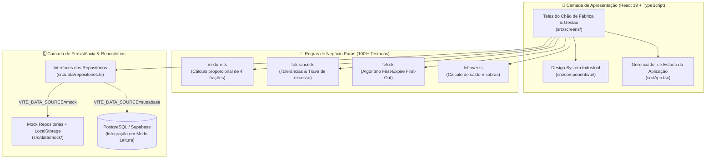

# 🏗️ Arquitetura de Software e Engenharia de Sistema

> **Mada Marcenaria — Gerenciador de Químicos & Fórmulas PU**  
> Documento técnico de arquitetura, padrões de projeto, decisões de engenharia e modelagem de software.

---

## 📌 Sumário

1. [Visão Geral da Arquitetura](#1-visão-geral-da-arquitetura)
2. [Divisão em Camadas (Separation of Concerns)](#2-divisão-em-camadas-separation-of-concerns)
   - [Camada de Domínio Puro (src/domain/)](#21-camada-de-domínio-puro-srcdomain)
   - [Camada de Repositórios & Abstração de Dados (src/data/)](#22-camada-de-repositórios--abstração-de-dados-srcdata)
   - [Camada de Interface & Design System Industrial (src/components/ui/ & src/screens/)](#23-camada-de-interface--design-system-industrial)
3. [Decisões de Engenharia para Chão de Fábrica](#3-decisões-de-engenharia-para-chão-de-fábrica)
4. [Dual-Engine de Leitura QR Code](#4-dual-engine-de-leitura-qr-code)
5. [Controle de Ciclo de Vida Químico (Pot Life de 20 min)](#5-controle-de-ciclo-de-vida-químico-pot-life-de-20-min)
6. [Estrutura Completa de Diretórios](#6-estrutura-completa-de-diretórios)
7. [Garantia de Qualidade & Testes Automatizados](#7-garantia-de-qualidade--testes-automatizados)

---

## 1. Visão Geral da Arquitetura

O sistema foi arquitetado como uma aplicação web moderna, desacoplada e independente de infraestrutura local, voltada prioritariamente para dispositivos móveis operados em suporte rígido de parede (*tablet-first*).



---

## 2. Divisão em Camadas (Separation of Concerns)

A arquitetura adota princípios de **Clean Architecture** e **Modular Design**, garantindo que a lógica matemática e operacional seja totalmente independente da interface gráfica ou do mecanismo de armazenamento.

### 2.1 Camada de Domínio Puro (`src/domain/`)

Módulos em TypeScript estrito, livres de dependências externas (sem React, sem hooks, sem I/O). Executam em velocidade nativa e possuem determinismo matemático:

- **`mixture.ts`:** Decompõe qualquer volume final pretendido nas proporções exatas dos 4 componentes fundamentais de pintura PU:
  - **Base** (tinta ou verniz);
  - **Catálise** (endurecedor alifático);
  - **Diluidor** (solvente redutor de viscosidade);
  - **Retardador** (aditivo térmico/antibranqueamento).
- **`tolerance.ts`:** Aplica o algoritmo de barreira anti-erro. Calcula a margem segura de pesagem ($\le 5\%$ do volume previsto ou no máximo $200\text{ ml}$). Se ultrapassada, gera o bloqueio impeditivo.
- **`fefo.ts`:** Implementa a lógica *First Expire, First Out*. Ordena frascos e galões priorizando primeiro embalagens violadas e depois os lotes mais próximos da data de expiração.
- **`leftover.ts`:** Calcula o saldo remanescente em embalagens abertas, gerando identificador único para rotulagem de retorno ao almoxarifado.

### 2.2 Camada de Repositórios & Abstração de Dados (`src/data/`)

Adota o padrão de projeto **Repository Pattern**. A interface do usuário nunca acessa diretamente um banco de dados ou um endpoint de API:

- **Contratos TypeScript (`repositories.ts`):** Definem interfaces explícitas para `ProdutoRepository`, `LoteRepository`, `OsRepository`, `ReceitaRepository` e `MovimentacaoRepository`.
- **Implementação Mock Local (`src/data/mock/`):** Utilizada no MVP. Armazena dados na memória com persistência reativa em `localStorage`, permitindo demonstrar o sistema offline e sem custos de nuvem.
- **Implementação Supabase (Planejada):** Permutável instantaneamente alterando a variável `VITE_DATA_SOURCE=supabase`, conectando às tabelas de insumos existentes da Mada Marcenaria em modo somente-leitura.

### 2.3 Camada de Interface & Design System Industrial

Projetada com base no conceito de **UX Defensiva**:

- **Componentes Táteis (`src/components/ui/`):** Botões ampliados (`Button.tsx`), teclados virtuais (`NumericKeypad.tsx`), campos PIN acessíveis (`PinInput.tsx`), visualizador dinâmico de béquer graduado (`BeakerVisualizer.tsx`) e gráfico tátil de auditoria (`ScrubChart.tsx`).
- **Navegação por Máquina de Estados:** A alternância de telas e fluxos é gerenciada via estado determinístico em `src/App.tsx`, eliminando problemas de histórico de navegação em tablets de quiosque/parede.

---

## 3. Decisões de Engenharia para Chão de Fábrica

Ambientes fabris agressivos (solventes no ar, névoa de tinta, uso de luvas e ruído) demandam soluções de engenharia específicas:

| Decisão de Engenharia | Desafio Real de Fábrica | Solução Implementada |
| :--- | :--- | :--- |
| **Ergonomia para Luvas & Resíduos** | Operadores trabalham em pé com luvas nitrílicas sujas de laca e solvente; toques milimétricos falham. | Teclas táteis de 64px a 90px, teclados numéricos virtuais em tela, botões de alto contraste e ausência de gestos complexos. |
| **Câmera Frontal (Selfie) com Espelho** | O tablet fica afixado em suporte chumbado na parede; a câmera traseira fica tapada pela estrutura física. | Câmera configurada com `facingMode: 'user'` e **espelhamento horizontal nativo**, permitindo apresentar frascos de frente para o tablet. |
| **Medição por Volume em Béquer (ml)** | A oficina de pintura não possui balanças digitais de precisão nas bancadas de preparação. | Padronização em **mililitros (ml)** com escala visual de béquer simulando a altura real do líquido na bancada. |
| **Trava Ativa Impeditiva (+5% / +200ml)** | Erros de dosagem estragam peças caras e desperdiçam catalisadores importados de alto custo. | A interface trava a confirmação da pesagem e exige PIN de supervisor (`9999`) com justificativa formal. |
| **Tema Escuro & Monocromático de Alto Contraste** | Reflexos de lâmpadas tubulares de cabine de pintura em telas de vidro. | Paleta industrial de alto contraste com superfícies em preto puro e cinza chumbo, reduzindo reflexos e fadiga visual. |

---

## 4. Dual-Engine de Leitura QR Code

A leitura óptica de etiquetas e Ordens de Serviço é executada por um motor híbrido e resiliente ([`QrScannerModal.tsx`](src/components/modals/QrScannerModal.tsx)):

1. **Motor Primário (Hardware Nativo):** Utiliza a API `BarcodeDetector` nativa dos navegadores baseados em Chromium (Google Chrome e Edge no Android/Desktop), com decodificação direta por aceleração de GPU.
2. **Motor Secundário (Fallback Canvas):** Caso a aplicação seja executada em navegadores sem suporte nativo à API (como Safari/iPadOS), o sistema ativa transparentemente um pipeline em tempo real com `requestAnimationFrame` renderizando os quadros de vídeo em um `<canvas>` invisível processado pela biblioteca leve `jsQR`.
3. **Mecanismo de Teste & Bypass:** Na ausência de câmera física conectada, a interface disponibiliza botões de simulação tátil para testes instantâneos de bancada.

---

## 5. Controle de Ciclo de Vida Químico (Pot Life de 20 min)

As tintas e vernizes de poliuretano (PU) reagem irreversivelmente com o catalisador alifático. O tempo hábil de aplicação antes que a mistura comece a empedrar e danifique a pistola é de **exatamente 20 minutos**:

- **Timer Regressivo em Tempo Real:** Acionado no momento da conclusão do preparo ([`PotLifeTimerBanner.tsx`](src/components/ui/PotLifeTimerBanner.tsx)).
- **Persistência de Sessão:** O horário de expiração é salvo no `localStorage`, garantindo que o cronômetro não se perca caso o tablet seja reiniciado ou o navegador recarregado.
- **Autodescarte Consciente:** Se o tempo expirar sem aplicação, o sistema orienta e registra o descarte do produto em tambor de resíduo químico, rateando o custo do refugo na Ordem de Serviço correspondente.

---

## 6. Estrutura Completa de Diretórios

```text
mada/
├── .agents/                      # Diretrizes de engenharia dos agentes de IA
├── .github/                      # Workflows de CI/CD (GitHub Actions para deploy no Pages)
│   └── workflows/deploy.yml
├── assets/                       # Assets gráficos e diagramas
├── docs/                         # Documentação técnica e de negócio completa
│   ├── screens/                  # Capturas de tela homologadas
│   ├── CANVAS.md                 # Project Model Canvas (PMC)
│   ├── DECISOES_E_REUNIOES.md    # Atas de alinhamento com o patrocinador (Fabio)
│   ├── DESIGN.md                 # Princípios de usabilidade industrial
│   ├── DESIGN_SYSTEM.md          # Especificação canônica dos design tokens
│   └── PROJETO.md                # Requisitos funcionais, SMART e cronograma
├── src/
│   ├── components/
│   │   ├── modals/               # Diálogos e modais centralizados (lazy/code-split)
│   │   │   ├── ModalCancelPrep.tsx         # Confirmação de descarte de preparo
│   │   │   ├── ModalCriticalExcess.tsx     # Trava de segurança para excesso dosado
│   │   │   ├── ModalNewBatch.tsx           # Cadastro rápido de novo lote em estoque
│   │   │   ├── ModalOcorrenciaMistura.tsx  # Registro de resíduo de mistura pronta
│   │   │   ├── ModalQrPackageResult.tsx    # Feedback de leitura de embalagens
│   │   │   ├── ModalUseFirst.tsx           # Alerta de violação de FEFO
│   │   │   └── QrScannerModal.tsx          # Scanner dual-engine (carregamento sob demanda)
│   │   └── ui/                   # Design System industrial e componentes reutilizáveis táteis
│   │       ├── AppShell.tsx           # Barra superior de status e contexto fabril
│   │       ├── BeakerVisualizer.tsx   # Simulação gráfica de béquer com graduação em ml
│   │       ├── NumericKeypad.tsx      # Teclado numérico industrial de 90px
│   │       ├── PinInput.tsx           # Input acessível de PIN de 4 dígitos
│   │       ├── PotLifeTimerBanner.tsx # Monitor de tempo útil de catalisação
│   │       ├── ScrubChart.tsx         # Gráfico tátil de auditoria de consumo e sobras
│   │       └── ...
│   ├── data/                     # Camada de Repositórios (Repository Pattern)
│   │   ├── __tests__/            # Testes de persistência de repositórios
│   │   ├── mock/                 # Fonte de dados simulada com mockData.ts
│   │   └── repositories.ts       # Contratos TypeScript dos repositórios
│   ├── domain/                   # Motores de regra de negócio puros (TypeScript puro)
│   │   ├── __tests__/            # Testes unitários com Vitest (8 suítes com 53 testes)
│   │   ├── fefo.ts               # Ordenação FEFO (First Expire, First Out)
│   │   ├── leftover.ts           # Cálculo de volume e reaproveitamento de sobras
│   │   ├── mixture.ts            # Cálculo proporcional de misturas químicas
│   │   ├── operationalLocks.ts   # Travas de cabine e bloqueios operacionais
│   │   ├── potLife.ts            # Ciclo de vida e ocorrências de pot life
│   │   ├── qrIdentification.ts   # Classificação e parsing de QR Codes industriais
│   │   ├── returnFlow.ts         # Fluxo completo de conferência e devolução
│   │   └── tolerance.ts          # Tolerâncias e barreira anti-erro (+5% / +200ml)
│   ├── hooks/                    # Hooks reutilizáveis e isolados de estado
│   │   ├── useConnectionStatus.ts    # Monitoramento de status de rede online/offline
│   │   ├── useOrderSelection.ts      # Seleção e vinculação de OS, lote e ambientes
│   │   ├── usePotLifeTimer.ts        # Cronômetro regressivo e descarte do pot life
│   │   ├── usePreparationWorkflow.ts # Orquestrador de dosagens, baixas e encerramentos
│   │   └── usePurchasesRequests.ts   # Gestão de solicitações de reposição
│   ├── screens/                  # Telas operacionais e gerenciais modulares
│   │   ├── ScreenAuth/           # Login rápido com teclado tátil e PIN
│   │   ├── ScreenDashboard/      # Painel tátil primário da cabine
│   │   ├── ScreenOS/             # Vinculação da OS (Cliente, Projeto, Ambiente)
│   │   ├── ScreenRecipe/         # Seleção e cálculo de receita química
│   │   ├── ScreenDosing/         # Dosagem guiada com béquer interativo
│   │   ├── ScreenReturn/         # Devolução modularizada (conferência, histórico, etiqueta)
│   │   ├── ScreenManager/        # Gestão executiva (cabines vivas, auditoria, KPIs, tabela)
│   │   └── ScreenInventory/      # Controle de estoque FEFO e solicitações de compras
│   ├── styles/                   # Folhas de estilo modulares e Design Tokens
│   │   ├── screens/              # CSS específico de cada tela
│   │   ├── design-system.css     # Estilos canônicos dos componentes táteis
│   │   ├── shell.css             # Estrutura global enxuta e barra fixa industrial
│   │   └── tokens.css            # Variáveis CSS (cores, tipografia Geist, espaçamentos)
│   ├── App.tsx                   # Máquina de estados principal da aplicação
│   ├── main.tsx                  # Ponto de montagem React 19
│   └── types.ts                  # Tipagem TypeScript canônica do domínio
├── package.json                  # Dependências e scripts de execução
├── tsconfig.json                 # Checagem estrita de tipos TypeScript
└── vite.config.ts                # Bundler Vite configurado para porta 3000
```

---

## 7. Garantia de Qualidade & Testes Automatizados

A estabilidade das regras de negócio matemáticas e da camada de persistência é assegurada por **53 testes unitários automatizados** executados via **Vitest**:

```bash
npm run test        # Executa as suítes de testes unitários
npm run lint        # Validação estática com ESLint 10 (Flat Config)
npm run typecheck   # Checagem de tipagem estrita com TypeScript (tsc --noEmit)
npm run build       # Compilação e empacotamento otimizado para produção (Code-splitting)
```

As 8 suítes cobrem:
1. `mixture.test.ts`: Proporcionalidade exata das 4 frações para volumes de 100 ml a 5.000 ml e tolerâncias a entradas nulas/negativas.
2. `tolerance.test.ts`: Disparo rigoroso da trava quando o excesso ultrapassa 5% ou 200 ml e cálculo de custo de refugo.
3. `fefo.test.ts`: Ordenação de prioridade de uso por validade, status de abertura do lote e alocação multi-lote FEFO.
4. `leftover.test.ts`: Cálculo de saldo residual e rotulagem para reaproveitamento no almoxarifado.
5. `potLife.test.ts`: Ciclo de vida da mistura catalisada, contagem regressiva e descarte consciente.
6. `returnFlow.test.ts`: Workflow de conferência de sobras, pendências e encerramento.
7. `operationalLocks.test.ts`: Travas de cabine e bloqueio de múltiplas preparações simultâneas.
8. `repositories.test.ts`: Integridade dos contratos de dados e repositórios locais.
