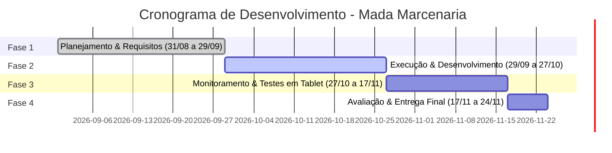

# 🪵 Mada Marcenaria — Sistema de Gestão de Químicos & Receitas

> **Projeto de Curricularização Acadêmica**  
> Solução web *tablet-first* para controle de estoque, pesagem, consumo e devolução de insumos químicos (tintas, vernizes, catalisadores e solventes) no setor de pintura e acabamento de marcenaria de alto padrão.

---

## 📌 Sumário
- [1. Contexto & Apresentação da Empresa](#1-contexto--apresentação-da-empresa)
- [2. O Problema & Diagnóstico](#2-o-problema--diagnóstico)
- [3. A Solução Proposta](#3-a-solução-proposta)
- [4. Objetivos do Projeto (SMART)](#4-objetivos-do-projeto-smart)
- [5. Partes Interessadas & Equipe](#5-partes-interessadas--equipe)
- [6. Requisitos do Sistema](#6-requisitos-do-sistema)
  - [Requisitos Funcionais (RF)](#requisitos-funcionais-rf)
  - [Requisitos Não Funcionais (RNF)](#requisitos-não-funcionais-rnf)
- [7. Cronograma & Backlog de Entregas](#7-cronograma--backlog-de-entregas)
- [8. Análise de Viabilidade, Custos & Riscos](#8-análise-de-viabilidade-custos--riscos)
- [9. UX, Design & Arquitetura de Telas](#9-ux-design--arquitetura-de-telas)
- [10. Tecnologias Utilizadas](#10-tecnologias-utilizadas)
- [📄 Project Model Canvas (PMC) Completo (CANVAS.md)](file:///c:/Users/Usuario/Desktop/mada/CANVAS.md)
- [📝 Registro de Decisões, Reuniões e Feedbacks (DECISOES_E_REUNIOES.md)](file:///c:/Users/Usuario/Desktop/mada/DECISOES_E_REUNIOES.md)

---


## 1. Contexto & Apresentação da Empresa

A **Mada Marcenaria**, localizada em São Bernardo do Campo – SP, é uma marcenaria tradicional e familiar que atravessa três gerações (desde o avô até os atuais gestores Fábio, sua mãe e sua ex-esposa). Atua no nicho de móveis sob medida e marcenaria de **alto padrão**, atendendo renomados escritórios de arquitetura, construtoras, imobiliárias e clientes de perfil exigente.

- **Estrutura:** Amplo galpão industrial equipado com maquinários modernos.
- **Quadro de Pessoal:** Aproximadamente 120 colaboradores divididos entre RH, Engenharia de Produção, Gestão, TI, Operadores de Máquinas, Marceneiros e Pintores.
- **Etapa Crítica:** O setor de **Pintura e Acabamento** representa um dos processos mais custosos e determinantes para a qualidade final da peça entregue.

---

## 2. O Problema & Diagnóstico

Durante a imersão e o diálogo direto com Fábio (gestor da Mada Marcenaria), identificou-se que a empresa **não possui um gerenciador próprio para insumos químicos e receitas**.

> *"Composição e mistura, eles sabem de cabeça, e isso é um problema. Preferiria ter um tablet com as receitas, sabe? E eles darem baixa no que forem usando, E ASSOCIAR PARA QUAL CLIENTE E AMBIENTE, devolve a lata pro estoque com os valores..."*  
> — **Fábio, gestor da Mada Marcenaria**

### Principais Dores Diagnosticadas:
1. **Dependência da Memória ("Sabem de Cabeça"):** As receitas e proporções não estão centralizadas em um sistema digital. Se um operador com experiência falta ou se a marca de tinta muda, ocorrem erros críticos de proporção.
2. **Perda de Produtos Abertos:** Latas de químicos de alto valor (bases, vernizes PU, catalisadores, diluidores e retardadores) são abertas para atender a uma ordem de serviço, não são consumidas por completo e retornam ao almoxarifado sem registro de saldo ou identificação.
3. **Vencimento no Estoque:** Como não há controle de prioridade (FIFO/FEFO por validade), operadores acabam abrindo novas latas lacradas enquanto recipientes abertos ou com validade próxima vencem na prateleira.
4. **Custeio e Rastreabilidade Imprecisos:** Dificuldade em apontar o gasto real de químicos por projeto, cliente e ambiente.
5. **Variação entre Marcas e Fórmulas:** Mudanças de fabricantes alteram as proporções das receitas, gerando desperdício e retrabalho.

---


## 3. A Solução Proposta

Desenvolvimento de uma **aplicação web em TypeScript**, otimizada para operação em **tablets no chão de fábrica**, integrada à rotina operacional do setor de pintura e acabamento da Mada Marcenaria.

```
       [ Ordem de Serviço (Cliente / Projeto / Ambiente) ]
                              │
                              ▼
        [ Consulta de Receita & Gabarito da Marca ]
                              │
                              ▼
      [ Calculadora Dinâmica de Mistura (Bases/Catalisadores) ]
                              │
                              ▼
          [ Baixa com Validação Anti-Erro & QR Code ]
                              │
                ┌─────────────┴─────────────┐
                ▼                           ▼
      [ Consumo Efetivo ]          [ Devolução de Sobras ]
    (Registro no Projeto)       (Re-etiquetagem com QR Code)
```

### Principais Pilares:
- **Tablet-First & Chão de Fábrica:** Botões dimensionados para toque com luvas, contraste elevado sob iluminação fabril e fluxos de poucos toques.
- **Prevenção Ativa de Erros (UX Defensiva):** Bloqueios visuais e alertas caso o volume retirado destoe da receita padrão ("sistema anti-erro").
- **Cálculo da Formulação Quádrupla:** O motor recalcula automaticamente os 4 componentes essenciais:
  - **Base** (tinta ou verniz);
  - **Catálise (PU):** Reagente de cura para alto brilho e resistência;
  - **Diluidor:** Ajuste de viscosidade para aplicação;
  - **Retardador:** Estabilizador de secagem contra umidade/névoa.
- **Padrão Técnico de Cores:** Compatibilidade com o catálogo [Sayerlack — Sayersystem](https://www.sayerlack.com.br/cartela_sayersystem.pdf).
- **Rastreabilidade por QR Code:** Identificação rápida de insumos e rotulagem de sobras com registro de volume remanescente.
- **Descarte Ambientalmente Consciente:** O resíduo consumido é direcionado para tambores de coleta de empresas especializadas de destinação ambiental.
- **Meta Operacional:** **Redução de 20% no desperdício de materiais químicos** até novembro de 2026.

---


## 4. Objetivos do Projeto (SMART)

### 🎯 Objetivo Central (SMART)
> **"Desenvolver e implantar, até novembro de 2026, um protótipo de sistema web otimizado para tablets, integrado ao sistema existente da empresa, capaz de registrar e controlar a retirada, o consumo e a devolução de materiais utilizados na produção, permitindo comparar o consumo realizado com os parâmetros definidos e contribuindo para uma redução de 20% no desperdício de materiais."**

### Objetivos Específicos
- Centralizar o catálogo de receitas e acabamentos homologados pela marcenaria.
- Permitir consulta ágil e recalculada de misturas em tablets operacionais.
- Registrar a baixa de produtos com rastreabilidade por Cliente, Projeto, Ambiente e Etapa.
- Gerenciar embalagens parciais (ex: latas de 1L ou galões) e devolução formal de sobras ao estoque.
- Priorizar a ordem de uso de materiais pela data de validade (mitigando perdas por vencimento).
- Permitir leitura e identificação de insumos via QR Code.
- Mapear a relação entre Marcas, Produtos e Fórmulas, suportando trocas de fornecedores sem perda de consistência.
- Desenvolver a solução sem dependência de instalação em servidores locais físicos da empresa.

---

## 5. Partes Interessadas & Equipe

### Stakeholders Externos
| Stakeholder | Papel & Interesse Principal |
| :--- | :--- |
| **Mada Marcenaria (Diretoria / Fábio)** | Patrocinadora; validação de regras de negócio, redução de custos e de desperdício. |
| **Operadores (Pintores e Marceneiros)** | Usuários finais no tablet; agilidade na consulta de receitas e baixa sem burocracia. |
| **Almoxarifado & Compras** | Controle de estoque físico, recebimento de sobras, gestão de validades e compras assertivas. |
| **Gerência de Produção & Engenharia** | Acompanhamento do previsto vs. realizado e custos reais por projeto. |
| **Instituição de Ensino & Professores** | Orientação metodológica, avaliação acadêmica e monitoria do projeto de curricularização. |

### Estrutura da Equipe de Desenvolvimento
1. **Gerente de Projeto (PM):** Gestão do cronograma, comunicação com a empresa e entregáveis acadêmicos.
2. **Banco de Dados:** Modelagem conceitual, lógica e física relacional (DER).
3. **Integração:** Arquitetura de rede, testes de conexão fabril e integração de dados.
4. **Back-end:** Desenvolvimento da API em TypeScript e motor de cálculo de misturas/regras de sobras.
5. **Front-end / UX:** Prototipagem Figma, usabilidade *tablet-first* e telas web responsivas.


---

## 6. Requisitos do Sistema

### Requisitos Funcionais (RF)
- [x] **RF01 - Catálogo de Receitas:** Centralizar e permitir a consulta de fichas técnicas de acabamento (tintas, resinas, vernizes, seladores).
- [x] **RF02 - Proporções Exatas:** Apresentar produtos e volumes calculados dinamicamente com base na quantidade final desejada.
- [x] **RF03 - Rastreabilidade de Consumo:** Registrar retirada e baixa vinculando a Cliente, Projeto, Ambiente e Fase produtiva.
- [x] **RF04 - Gestão de Embalagens Parciais (Sobras):** Registrar o volume parcial consumido e o retorno do saldo remanescente ao almoxarifado.
- [x] **RF05 - Previsto vs. Real:** Comparar o consumo real apontado com os parâmetros definidos na receita teórica.
- [x] **RF06 - Priorização por Validade:** Indicar a ordem prioritária de retirada de produtos com base no lote e validade (FEFO).
- [x] **RF07 - Identificação via QR Code:** Leitura de etiquetas de produtos e ordens de serviço via câmera do tablet.
- [x] **RF08 - Gestão Multimarca:** Associar insumos e receitas às marcas correspondentes, ajustando fórmulas conforme o fabricante em uso.

### Requisitos Não Funcionais (RNF)
- **RNF01 - Usabilidade Tablet-First:** Interface com botões grandes, áreas de toque expandidas, alto contraste e fluxo à prova de erro (uso com luvas/sujeira de oficina).
- **RNF02 - Compatibilidade Web:** Aplicação web responsiva desenvolvida em TypeScript, executável em navegadores modernos em tablets (Android/iPadOS) e desktop.
- **RNF03 - Resiliência & Desempenho:** Aplicação leve, com tempos de resposta mínimos para operar mesmo sob oscilações do sinal Wi-Fi no galpão.
- **RNF04 - Segurança & Backups:** Rotinas diárias de backup de dados operacionais e de estoque em nuvem.
- **RNF05 - Manutenibilidade:** Código modular e banco de dados relacional bem estruturado para inclusão ágil de novas receitas, insumos e fornecedores.

---

## 7. Cronograma & Backlog de Entregas

### Fases do Projeto (Ciclo Acadêmico)



### Backlog de Entregas
- **Entrega 1:** Documentação detalhada das regras de negócio, validação de requisitos de sobras e processos com a Mada Marcenaria.
- **Entrega 2:** Protótipos de alta fidelidade no Figma e modelagem estrutural do banco de dados relacional (*Clientes, Ambientes, Receitas, Materiais, Lotes e Movimentações*).
- **Entrega 3:** Desenvolvimento da aplicação web (Front-end + API em TypeScript) com a lógica de cálculo de misturas e regras de consumo.
- **Entrega 4:** Integração completa, testes de conectividade em ambiente fabril e validação de usabilidade com tablets.
- **Entrega 5:** Homologação com a empresa, refinamento de feedbacks, entrega do MVP funcional, manual de instrução de uso e **Treinamento/Capacitação presencial dos operadores no uso dos tablets**.

---

## 8. Análise de Viabilidade, Custos & Riscos

### Estimativa Financeira & Orçamento do Piloto

| Rubrica | Cenário Comercial (Mercado) | Cenário Acadêmico (Piloto Mada) |
| :--- | :--- | :--- |
| **Mão de Obra de Desenvolvimento** | R$ 25.000,00 *(5 devs / 3 meses)* | **R$ 0,00** *(subsidiado pela disciplina)* |
| **Infraestrutura / Servidor / Rede** | R$ 100,00/mês *(Cloud + Backup)* | **R$ 0,00** *(absorvido pela estrutura local da fábrica)* |
| **Domínio / Registro** | ~R$ 40,00 anuais | **R$ 0,00** *(acesso via rede local / IP interno)* |
| **Despesas Operacionais (Visitas/Testes de rede)** | Inclusas em contrato | **R$ 150,00** *(deslocamento presencial para testes na fábrica)* |
| **TOTAL DO INVESTIMENTO** | **R$ 25.140,00+** | **R$ 150,00** |

> 📌 Para a visualização detalhada em matriz do planejamento inicial, consulte o [CANVAS.md](file:///c:/Users/Usuario/Desktop/mada/CANVAS.md).


### Matriz de Riscos & Planos de Ação

| Risco | Categoria | Impacto | Mitigação |
| :--- | :--- | :--- | :--- |
| Uso com luvas, poeira e tinta no tablet | Operacional | Alto | UI com áreas de clique amplas, botões sem dependência de gestos complexos e confirmações claras. |
| Troca de marca sem aviso prévio | Negócio | Médio | Sistema com suporte nativo a formulações alternativas indexadas por marca. |
| Instabilidade de Wi-Fi no galpão | Técnico | Médio | Aplicação leve com cache de dados essenciais e feedback claro de status de rede. |
| Resistência operacional / erro humano | Operacional | Médio | UX defensiva com modais de confirmação ao ultrapassar volumes previstos e interface visual intuitiva. |

---

## 9. UX, Design & Arquitetura de Telas

O guia de design completo e as especificações de interface para chão de fábrica estão formalizados no documento:
👉 **Consulte as diretrizes completas em [DESIGN.md](file:///c:/Users/Usuario/Desktop/mada/DESIGN.md)**

### Resumo dos Fluxos Principais (Tablet):
1. **Login Rápido:** Seleção por operador + PIN numérico de 4 dígitos.
2. **Dashboard Operacional:** 3 ações primárias de impacto (`NOVA PREPARAÇÃO`, `DEVOLVER SOBRAS`, `ESCANEAR QR CODE`).
3. **Identificação da OS:** Associação direta a Cliente, Projeto e Ambiente.
4. **Ficha da Receita:** Calculadora automática da mistura a partir do volume total de acabamento.
5. **Check-out com Barreira Anti-Erro:** Modal de alerta caso o consumo digitado exceda o limite técnico da receita.
6. **Devolução & Re-etiquetagem:** Leitura do QR Code da embalagem aberta e registro do saldo que retorna ao estoque.

---

## 10. Tecnologias Utilizadas

- **Linguagem Principal:** [TypeScript](https://www.typescriptlang.org/)
- **Paradigma de Interface:** Web Responsive / Tablet-First (HTML5, Vanilla CSS com variáveis de design tokens)
- **Estrutura de Dados:** Relacional (compatível com PostgreSQL / SQLite / MySQL)
- **Identificação:** QR Code Scanner via WebRTC API