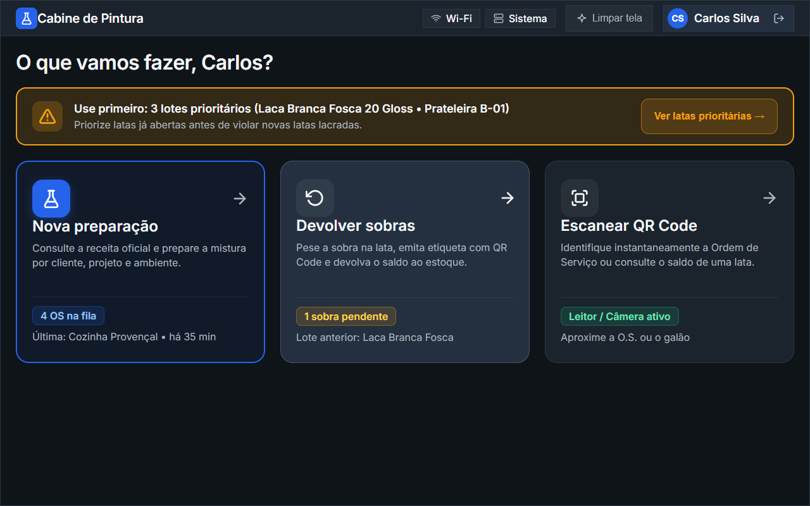
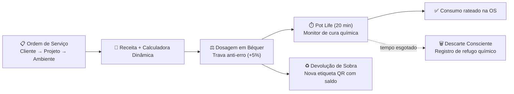
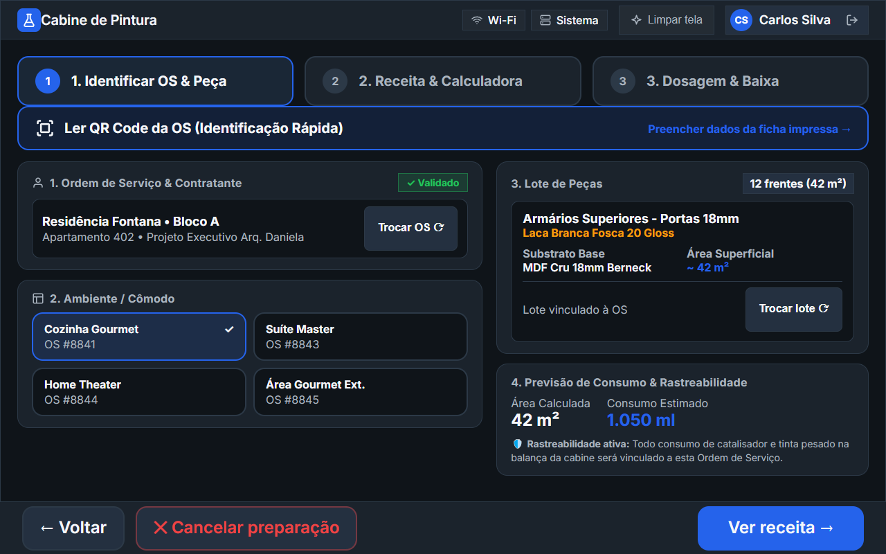
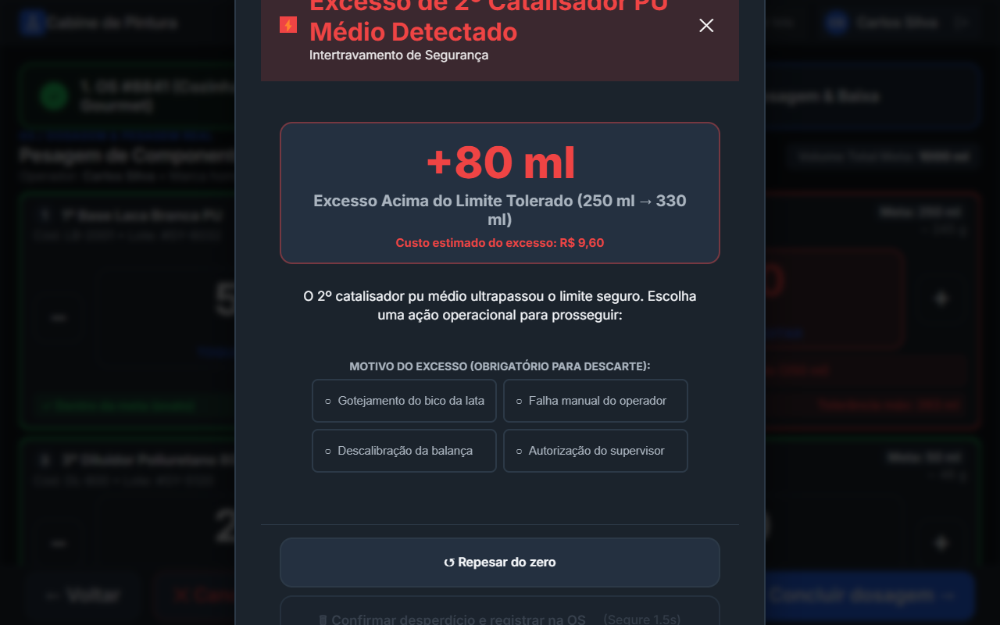
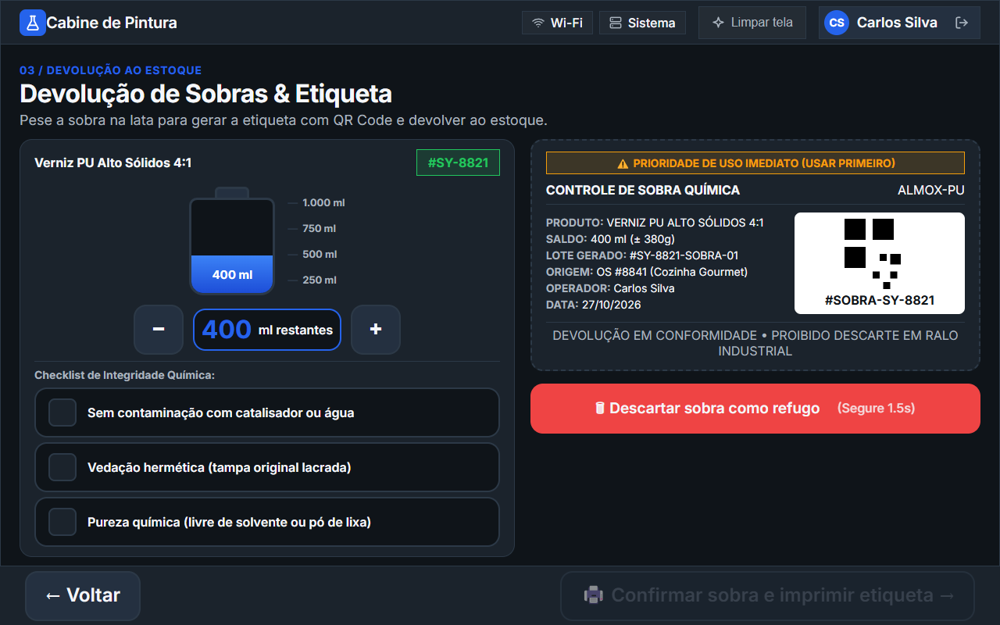
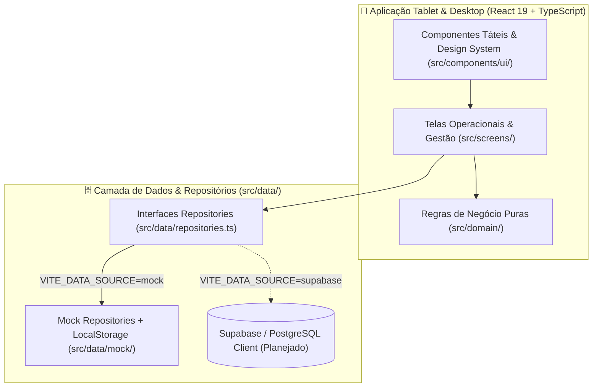

<div align="center">

# 🪵 Gerenciador de Químicos

**Receitas exatas, estoque sob controle e desperdício zero no setor de pintura.**

Sistema web _tablet-first_ para marcenarias de alto padrão: calcula misturas químicas dinâmicas, trava erros de dosagem, rastreia o consumo por cliente e ambiente, controla tempo de vida útil (*pot life*) e dá nova vida às sobras.

[](#-status-e-roadmap)
[](https://carvalhonathan.github.io/mada/)
[](https://www.typescriptlang.org/)
[](https://react.dev/)
[](https://vite.dev/)
[](#-telas)
[](#-testes-e-qualidade)

🔗 **Acesse a Demonstração Online:** [https://carvalhonathan.github.io/mada/](https://carvalhonathan.github.io/mada/)



</div>

---

## 💡 O Cenário: O Custo Invisível no Setor de Pintura

Em uma marcenaria de alto padrão, a cabine de pintura e acabamento utiliza os insumos mais nobres e caros da fábrica: bases poliuretano (PU), catalisadores alifáticos, diluidores especiais, retardadores térmicos e vernizes bi-componentes. 

Historicamente, as proporções de mistura vivem guardadas na cabeça dos operadores:

> _"Composição e mistura, eles sabem de cabeça, e isso é um problema. Preferiria ter um tablet com as receitas, sabe? E eles darem baixa no que forem usando, e associar para qual cliente e ambiente, devolve a lata pro estoque com os valores..."_  
> — **Fabio, gestor da Mada Marcenaria**

### As dores reais do chão de fábrica:
- **Erros de proporção:** dosagens imprecisas comprometem a secagem, o alastramento e a resistência mecânica da laca.
- **Sobras abandonadas:** latas abertas voltam para a prateleira sem medição de saldo, gerando perda silenciosa de matéria-prima.
- **Validade expirada:** produtos caros vencem no estoque porque operadores abrem frascos novos sem consumir os lotes abertos.
- **Custo cego:** impossibilidade de apurar quanto de química foi efetivamente investido em cada ambiente do cliente.
- **Perda de misturas catalisadas:** a mistura PU endurece irreversivelmente em 20 minutos (*pot life*), podendo danificar pistolas e estragar a peça final.

### 💸 A Conta do Desperdício: Quanto Custa Continuar no Jeito Antigo?
Em uma marcenaria sob medida com 2 a 3 cabines de pintura consumindo em média R$ 15.000 a R$ 20.000 mensais em químicos nobres (bases PU, catalisadores alifáticos e vernizes especiais), uma perda invisível de 15% a 20% significa **jogar fora de R$ 27.000 a R$ 48.000 por ano** diretamente no ralo:
- Latas abertas que vencem esquecidas no fundo das prateleiras;
- Excesso de catalisador ou solvente dosados "no olhômetro";
- Misturas descartadas na cabine por estouro do tempo de cura (*pot life*);
- Horas de retrabalho em peças prontas por defeitos de secagem e brilho.

---

## 🎯 Impacto de Negócio & Metas de Retorno (ROI)

Projetado especificamente para estancar esse prejuízo silencioso e transformar a cabine de pintura em uma operação de alta previsibilidade e desperdício zero:

| Meta de Impacto | O que representa na prática da fábrica |
| :--- | :--- |
| **−20% de Desperdício Químico** | Redução imediata de perda de matéria-prima nobre através de receitas recalculadas milimetricamente e reaproveitamento de sobras. |
| **100% de Rastreabilidade na OS** | Rateio financeiro exato: a marcenaria passa a saber o centavo real de química gasto por **Cliente ➔ Projeto ➔ Ambiente**. |
| **Zero Perda por Validade (FEFO)** | Algoritmo *First Expire, First Out* que obriga o consumo de latas já abertas e lotes críticos antes da violação de novos frascos. |
| **Proteção de Peças & Ferramental** | Monitor de cura de 20 min (*pot life*) que impede a aplicação de laca em fase de gelificação e evita entupimento de pistolas. |
| **Fim da Dependência de Memória** | Padronização integral do catálogo técnico (padrão Sayerlack / Sayersystem e homologados), acessível a qualquer operador. |

---

## ✨ A Solução: Engenharia de Detalhes Pensada para Chão de Fábrica

> 🏭 **Feito para a Rotina Real da Fábrica (Zero Burocracia):**  
> *"Não construímos um software de escritório com ar-condicionado para tentar empurrar à força na fábrica. Cada botão tátil de 90px, a inversão da câmera para suporte de parede e a graduação em béquer (ml) nasceram da observação real do chão de fábrica: para o operador em pé, usando luvas nitrílicas sujas de solvente, registrar tudo em 3 toques rápidos, sem complicação."*

Não se trata de um sistema corporativo adaptado, mas de uma interface **projetada com soluções sob medida para a rotina real de uma cabine de pintura**:

| Funcionalidade Prática | Atenção ao Detalhe Operacional | O que resolve no Chão de Fábrica |
| :--- | :--- | :--- |
| 📱 **Interface Tablet-First Industrial** | Teclas táteis de 90px, espaçamento generoso e ausência de gestos finos (swipe/pinça). | Operação em pé, ágil mesmo com luvas nitrílicas grossas e dedos sujos de tinta e solvente. |
| 🧪 **Motor Dinâmico de 4 Frações PU** | Cálculo instantâneo das 4 frações (Base + Catálise + Diluidor + Retardador) pelo volume desejado. | Acaba com a dependência de receitas guardadas "de cabeça" e previne misturas incorretas. |
| 🛑 **Trava Ativa Anti-Erro (+5% / +200ml)** | Bloqueio visual impeditivo se a retirada passar de +5% ou 200ml do gabarito da receita. | Erros críticos são barrados antes de acontecer, exigindo autorização com PIN supervisor. |
| ⏱️ **Monitor Regressivo de Pot Life (20 min)** | Cronômetro regressivo em tempo real com avisos sonoros/visuais e autodescarte orientado. | Protege contra a cura irreversível do PU na pistola e rateia o custo do refugo na OS. |
| 📅 **Protocolo FEFO ("Use Primeiro")** | Indicação visual no Dashboard e na seleção de lotes da lata mais antiga que deve ser consumida. | Reduz drasticamente perdas de produtos caros vencendo esquecidos na prateleira. |
| 🏷️ **Scanner Óptico Dual-Engine** | Câmera frontal com espelhamento nativo (para tablet em parede) e retículo laser animado. | Identificação instantânea de ordens de serviço e frascos sem precisar manusear o tablet. |
| ♻️ **Etiquetagem e Saldo de Sobras** | Cálculo automático do volume restante na lata e emissão imediata de nova etiqueta com QR Code. | Latas abertas voltam ao almoxarifado devidamente quantificadas e rastreadas. |
| 📊 **Painel Executivo & Auditoria Scrub** | Gráfico interativo tátil (*Scrub Chart*), KPIs em R$ e exportação de histórico em CSV. | Gestão executiva com total visibilidade do consumo previsto vs. realizado por obra. |

---

## 🔄 Fluxo operacional



---

## 🖼️ Telas e Módulos

| Login Rápido | Dashboard Operacional | Vinculação de OS |
| :---: | :---: | :---: |
|  |  |  |
| PIN de 4 dígitos (Apple HIG) e teclado tátil | Ações primárias e alerta FEFO | Cliente, projeto e ambiente em poucos toques |

| Receita & Proporções | Dosagem em Béquer | Trava de Tolerância | Devolução & Sobras |
| :---: | :---: | :---: | :---: |
|  |  |  |  |
| Cálculo em frações proporcionais | Visualizador de béquer com nível líquido | Bloqueio por excesso com PIN supervisor | Etiqueta de sobra com QR Code e saldo |

---

## 🚀 Experimente na Prática (Test Drive em 2 Minutos)

Pronto para ver a solução em ação? Acesse a **[Demonstração Online no GitHub Pages](https://carvalhonathan.github.io/mada/)** e siga este roteiro guiado para testar os principais diferenciais do produto:

1. **Entrada na Cabine:** No login, selecione um operador (ex: *Carlos Silva*) e digite o PIN `1234`.
2. **Vinculação de OS:** Toque em `NOVA PREPARAÇÃO` e escolha uma Ordem de Serviço ou clique em `SIMULAR LEITURA QR` para carregar o cliente e ambiente automaticamente.
3. **Cálculo da Mistura:** Selecione o acabamento desejado (ex: *Laca PU Alto Brilho Sayerlack*). Altere o volume total para `1.000 ml` e observe o recálculo dinâmico e proporcional das 4 frações (Base, Catálise PU, Diluidor e Retardador).
4. **Trava Anti-Erro em Ação:** Na dosagem em béquer, adicione intencionalmente mais de +5% de produto em um componente. O **Modal de Bloqueio Crítico** impedirá o avanço. Digite o PIN de supervisor `9999` para autorizar a justificativa.
5. **Monitor de Pot Life:** Conclua a preparação e veja o cronômetro regressivo de **20 minutos** entrar em ação no topo da aplicação, alertando sobre o tempo hábil antes da cura irreversível do PU.
6. **Auditoria Gerencial & Estoque:** Abra o menu lateral no canto superior esquerdo e explore:
   - **Painel do Gestor:** Gráfico tátil interativo (*Scrub Chart*), KPIs de desperdício em R$ e exportação de histórico em CSV.
   - **Gestão de Estoque:** Visualização de insumos por FEFO ("Use Primeiro"), registro de novos lotes e lista de compras.

---

## 🏗️ Arquitetura

O sistema adota os princípios de **Clean Architecture** e **Repository Pattern**, isolando rigorosamente a interface tátil das regras matemáticas puras de mistura e da fonte de dados (mock / Supabase).



> 📘 **Dossiê Técnico de Engenharia:** Para a árvore de diretórios detalhada, especificação do motor *Dual-Engine* de QR Code e todas as decisões ergonômicas de chão de fábrica, consulte **[ARCHITECTURE.md](./ARCHITECTURE.md)**.

---

## 🧰 Tecnologias

| Camada | Tecnologia | Situação |
| :--- | :--- | :--- |
| **Interface & Aplicação** | React 19, TypeScript, HTML5 semântico, CSS com Tokens | Implementado |
| **Tipografia & Design** | Geist Sans & Geist Mono, Design System Industrial de Alto Contraste | Implementado |
| **Ferramenta de Build** | Vite 8 (dev server em `localhost:3000`, HMR ultra rápido) | Implementado |
| **Camada de Dados (MVP)** | Repositórios em memória com persistência em `localStorage` | Implementado |
| **Regras de Negócio** | Módulos determinísticos puros em TypeScript isolados | Implementado |
| **Qualidade & Testes** | Vitest (25 testes unitários), ESLint 10 (Flat Config), Prettier | Implementado |
| **Scanner QR Code** | Dual-Engine: `BarcodeDetector` nativo + decodificador canvas `jsQR` | Implementado |
| **Banco de Dados Real** | PostgreSQL via Supabase (integração em modo de leitura) | Planejado |

---

## 🧪 Testes e qualidade

O projeto conta com ferramentas integradas de verificação estática, formatação e testes unitários automatizados:

- **Testes unitários (`npm run test`):** 25 testes em 5 arquivos com Vitest, cobrindo com rigor matemático as proporções de misturas, tolerâncias de dosagem, algoritmo FEFO e repositórios.
- **Análise estática (`npm run lint`):** ESLint 10 configurado para TypeScript e React.
- **Checagem estrita de tipos (`npm run typecheck`):** Validação com `tsc --noEmit`.
- **Build de produção (`npm run build`):** Otimização e minificação pelo Vite.

```bash
npm run test        # Executa a suíte de 25 testes unitários via Vitest
npm run lint        # Validação de regras e consistência de código
npm run typecheck   # Checagem rigorosa de tipos TypeScript
npm run build       # Gera os artefatos prontos para produção na pasta dist/
```

---

## 🚧 Status e roadmap

> O projeto é um **MVP demonstrável e funcional**. A conexão final com o banco de produção da marcenaria está arquitetada e aguarda a concessão das credenciais do Supabase.

### ✅ Já implementado no MVP

- [x] **Autenticação Tátil:** Teclado numérico PIN de 4 dígitos nos padrões Apple HIG, com resposta visual rápida e suporte a senha mestre de supervisor.
- [x] **Dashboard do Chão de Fábrica:** Painel de botões gigantes para operação em pé e card de aviso FEFO ("Use Primeiro").
- [x] **Identificação de Ordem de Serviço:** Rastreabilidade estruturada em três níveis (Cliente → Projeto → Ambiente).
- [x] **Calculadora Dinâmica de Mistura:** Cálculo instantâneo das frações de Base, Catálise, Diluidor e Retardador por volume total desejado.
- [x] **Dosagem em Béquer com Visualizador:** Visualização tátil do nível do líquido em tempo real, teclado numérico embutido e NumberStepper.
- [x] **Trava Anti-Erro Crítico:** Modal de bloqueio que impede misturas erradas (+5% ou +200ml) sem autorização do encarregado.
- [x] **Monitor de Pot Life (20 min):** Contagem regressiva em tempo real com avisos visuais de urgência e registro de autodescarte de refugo químico.
- [x] **Devolução de Sobras:** Cálculo automático de saldo remanescente na lata e emissão de etiqueta de sobra com QR Code.
- [x] **Scanner QR Dual-Engine com Mira Laser:** Câmera frontal com espelhamento para tablets em parede e suporte universal a Safari e Android.
- [x] **Gestão de Estoque e Compras:** Visualização de inventário, cadastro/recebimento de novos lotes e lista de reposição para compras.
- [x] **Painel Gerencial & Auditoria:** KPIs consolidados, gráfico interativo de consumo (*Scrub Chart*) e exportação do histórico em formato CSV.
- [x] **Qualidade:** 25 testes unitários automatizados cobrindo lógica matemática e repositórios.

### 📋 Próximos passos

- [ ] Conexão direta com as tabelas de produtos do Supabase da Mada Marcenaria (em modo leitura).
- [ ] Importação automatizada das Ordens de Serviço a partir do ERP da fábrica.
- [ ] Camada de sincronização offline via IndexedDB / Service Worker para resiliência a quedas de Wi-Fi.
- [ ] Homologação assistida com os operadores nas cabines de pintura.

---

## 📚 Documentação complementar

Acesse a **[Central de Documentação (docs/README.md)](docs/README.md)** para o índice completo e navegável de todos os documentos estratégicos e técnicos:

| Documento | Conteúdo |
| :--- | :--- |
| **[Arquitetura de Software](ARCHITECTURE.md)** | Diagramas detalhados, separação de camadas, decisões de engenharia fabril e árvore de arquivos |
| **[Documentação do Projeto](docs/PROJETO.md)** | Contexto de negócio, requisitos funcionais (RF), não-funcionais (RNF) e objetivos SMART |
| **[Project Model Canvas (PMC)](docs/CANVAS.md)** | Matriz visual de planejamento estratégico pós-banca acadêmica |
| **[Decisões e Reuniões](docs/DECISOES_E_REUNIOES.md)** | Atas de reuniões com o gestor Fabio e alinhamentos de bancas da faculdade |
| **[Guia de Design de Fábrica](docs/DESIGN.md)** | Diretrizes ergonômicas para uso de telas táteis em ambientes agressivos |
| **[Design System](docs/DESIGN_SYSTEM.md)** | Especificação canônica dos tokens de cor, tipografia Geist e componentes táteis |

---

## ▶️ Como executar o projeto localmente

### Pré-requisitos

- **Node.js:** `>=24.18.0` (definido em `.nvmrc` e no `package.json`).
- **npm:** Gerenciador de pacotes padrão do Node.

### Passo a passo

```bash
# 1. Clone o repositório
git clone https://github.com/carvalhonathan/mada.git

# 2. Acesse a pasta do projeto
cd mada

# 3. Instale as dependências
npm install

# 4. Inicie o servidor de desenvolvimento
npm run dev
```

Acesse no navegador através do endereço: `http://localhost:3000`.

> 💡 **Demonstração Online:** Caso prefira testar sem instalar dependências locais, utilize a versão publicada no GitHub Pages: [https://carvalhonathan.github.io/mada/](https://carvalhonathan.github.io/mada/)

---

### 👤 Operadores e PINs de teste (Dados Simulados)

| Perfil | Nome | PIN de Teste | Papel no Protótipo |
| :--- | :--- | :--- | :--- |
| **Operador** | Carlos Silva | `1234` | Pintor Líder • Cabine 01 |
| **Operador** | Ana Souza | `1234` | Aplicadora PU • Cabine 02 |
| **Operador** | Marcos Lima | `1234` | Auxiliar de Cabine |
| **Supervisor** | Fabio | `9999` (ou `1234`) | Liberação de excesso crítico e auditoria |

---

## 👥 Equipe & Contribuições

Projeto de curricularização acadêmica desenvolvido em parceria com a **Mada Marcenaria** (São Bernardo do Campo, SP):

| Integrante | Atribuições & Papel no Projeto | Contato / Links |
| :--- | :--- | :--- |
| **Nathan Carvalho** | **Liderança Técnica & Desenvolvimento Full Stack:** Arquitetura do sistema, engenharia de software, desenvolvimento Front-end & UI/UX *tablet-first*, regras de negócio em TypeScript, testes automatizados e deploy. | [](https://github.com/carvalhonathan) &bull; [](mailto:fariasnathan75@gmail.com) |
| **Gabriel** | **Relações com a Empresa Parceira & Documentação:** Contato inicial com a Mada Marcenaria, alinhamento nas reuniões com Fabio e apoio no levantamento e refinamento de documentação. | — |
| **Andrey** | **Suporte a Reuniões & Documentação:** Levantamento de anotações e atas das reuniões com a empresa parceira e auxílio na documentação acadêmica. | — |

> 🪵 Desenvolvido para modernização e gestão de acabamento químico no setor de pintura e laca PU.

---

## 📄 Licença e uso

Projeto acadêmico e profissional em processo de homologação junto à empresa parceira. Todos os direitos reservados.
