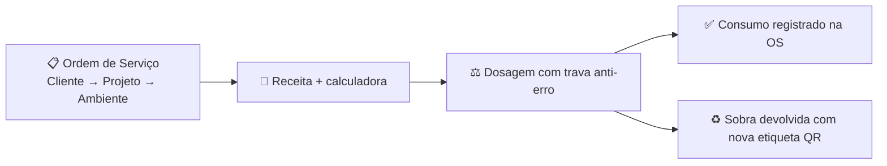
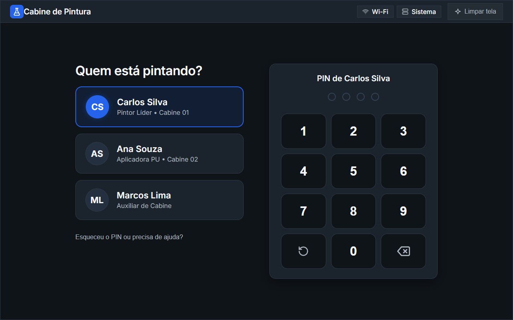
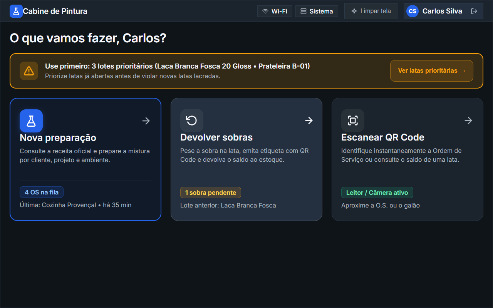
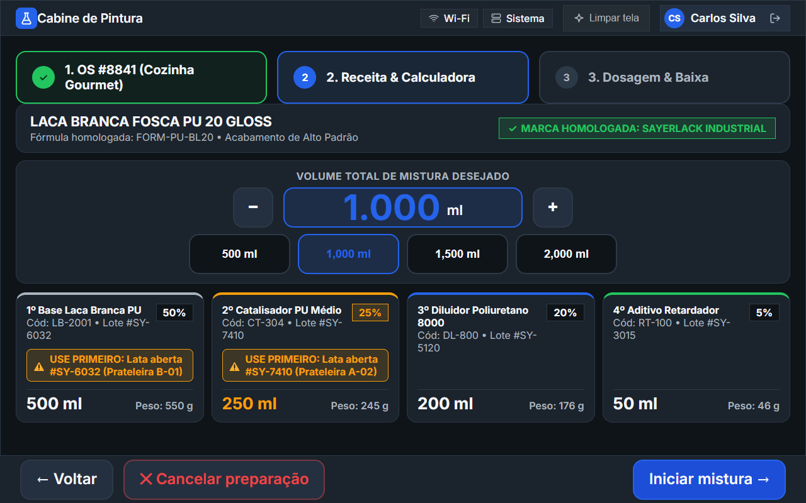
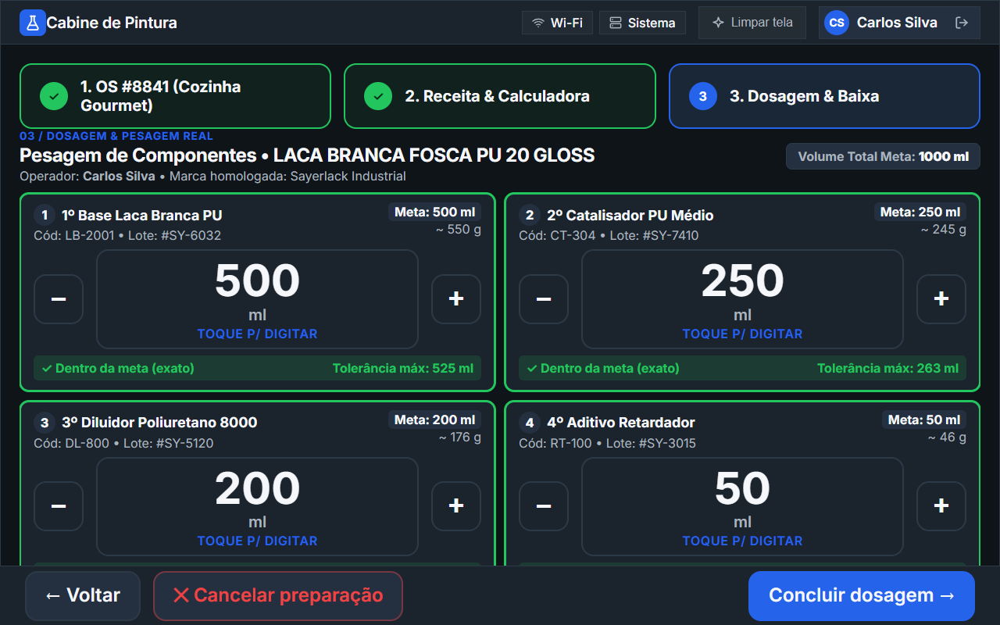
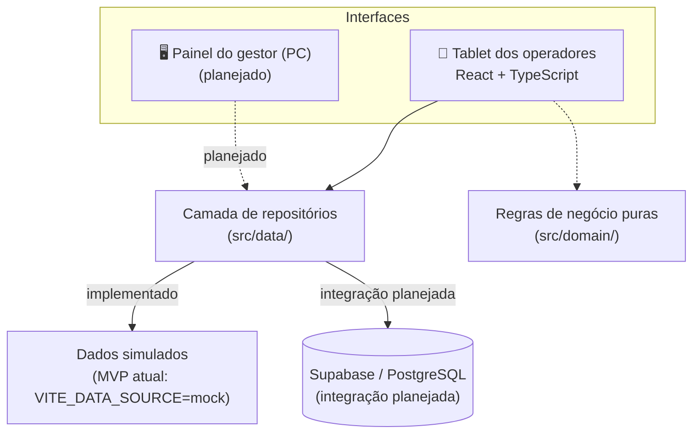

<div align="center">

# 🪵 Gerenciador de Químicos

**Receitas exatas, estoque sob controle e menos desperdício no setor de pintura.**

Sistema web _tablet-first_ para marcenarias de alto padrão: calcula misturas, trava erros de dosagem, rastreia o consumo por cliente e ambiente e dá nova vida às sobras.

[](#-status-e-roadmap)
[](https://carvalhonathan.github.io/mada/)
[](https://www.typescriptlang.org/)
[](https://react.dev/)
[](https://vite.dev/)
[](#-telas)

🔗 **Acesse a Demonstração Online:** [https://carvalhonathan.github.io/mada/](https://carvalhonathan.github.io/mada/)

<!-- [A PREENCHER] Troque pela imagem de capa (colagem das telas ou GIF do fluxo) -->


</div>

---

## 💡 O problema

Em uma marcenaria de alto padrão, o setor de pintura usa produtos caros (bases, catalisadores, diluidores, retardadores e vernizes PU) e as receitas de mistura vivem na cabeça dos pintores.

> _"Composição e mistura, eles sabem de cabeça, e isso é um problema. Preferiria ter um tablet com as receitas, sabe? E eles darem baixa no que forem usando, e associar para qual cliente e ambiente, devolve a lata pro estoque com os valores..."_  
> — Gestor da Mada Marcenaria

O resultado são proporções erradas, latas abertas que voltam ao estoque sem registro, produtos vencendo na prateleira e custo impreciso por obra.

## ✨ A solução

|     | Funcionalidade                     | O que resolve                                                                        |
| :-: | :--------------------------------- | :----------------------------------------------------------------------------------- |
| 📱  | **Interface tablet-first**         | Botões grandes e alto contraste, pensados para uso em pé, com luvas e mãos sujas.    |
| 🧪  | **Receitas dinâmicas**             | Informe o volume total e o sistema calcula base, catalisador, diluidor e retardador. |
| 🛑  | **Trava anti-erro**                | Alerta quando a quantidade retirada passa da receita, com justificativa obrigatória. |
| 📅  | **Prioridade por validade (FEFO)** | Mostra qual lata usar primeiro, para reduzir perdas por vencimento.                  |
| 🏷️  | **QR Code**                        | Identifica latas e ordens de serviço e gera nova etiqueta para as sobras.            |
| 📊  | **Painel do gestor** _(planejado)_ | Compara consumo previsto e real e acompanha o custo por cliente e ambiente.          |

## 🔄 Como funciona



## 🖼️ Telas

> **[A PREENCHER]** Adicione os prints em `docs/screens/`.

|                   Login                   |                  Dashboard                  |                 Vincular OS                  |
| :---------------------------------------: | :-----------------------------------------: | :------------------------------------------: |
|        |  |        |
| PIN de 4 dígitos nos padrões Apple HIG    |     Ações grandes e alerta de validade      | Cliente, projeto e ambiente em poucos toques |

|                 Receita                 |                 Dosagem                 |          Alerta de excesso           |                  Devolução                  |
| :-------------------------------------: | :-------------------------------------: | :----------------------------------: | :-----------------------------------------: |
|  |  |  |  |
|         Calculadora de mistura          |  Pesagem real em 2x2 com NumberStepper  |  Trava de segurança por tolerância   |          Nova etiqueta com QR Code          |

## 🎯 Impacto esperado

- **−20% de desperdício** de químicos (meta até novembro de 2026).
- Receitas padronizadas, sem depender da memória de cada operador.
- **Custo real** por cliente, projeto e ambiente.
- Menos latas vencidas e mais sobras reaproveitadas.

## 🏗️ Arquitetura



- **Camada de repositórios (`src/data/`):** Implementada para isolar a origem dos dados. O MVP roda com repositórios simulados em memória (`VITE_DATA_SOURCE=mock`). A troca para o Supabase é prevista por configuração de ambiente.
- **Regras de negócio puras (`src/domain/`):** Cálculos de frações de mistura, tolerâncias de pesagem, aproveitamento de sobras e ordenação FEFO desacoplados de qualquer camada visual.
- **Navegação por estado:** A alternância entre telas é gerenciada por estado local (`useState<ScreenId>`), sem biblioteca de roteamento externa (sem roteador).
- **Leitura de QR Code:** Leitura pela câmera do tablet (`getUserMedia` + `BarcodeDetector` nativo, suportado no Chrome/Edge/Android), com atalhos de simulação para teste sem câmera (`src/components/ui/QrScannerModal.tsx`). Fallback para Safari/iPadOS planejado.
- **Persistência local:** Os repositórios simulados gravam as movimentações no `localStorage` do navegador, mantendo os dados entre recarregamentos da página.

### 📁 Estrutura do projeto

```text
mada/
├── .agents/                      # Regras de agentes e diretrizes (ex.: convenções de commit)
├── .github/                      # Automação de CI/CD (GitHub Actions para deploy no Pages)
│   └── workflows/deploy.yml
├── assets/                       # Imagens de referência e ideias de UX
├── docs/                         # Documentação técnica e estratégica do projeto
│   ├── screens/                  # Capturas de tela da aplicação (.gitkeep)
│   ├── CANVAS.md                 # Project Model Canvas
│   ├── DECISOES_E_REUNIOES.md    # Registro de decisões e atas de reuniões
│   ├── DESIGN.md                 # Princípios de UX para chão de fábrica
│   ├── DESIGN_SYSTEM.md          # Especificação de tokens e componentes
│   └── PROJETO.md                # Documento de visão, requisitos e arquitetura
├── src/
│   ├── components/               # Componentes de interface modulares e reutilizáveis
│   │   └── ui/                   # Design System próprio (AppShell, NumericKeypad, PinInput, etc.)
│   ├── data/                     # Camada de repositórios e seletor VITE_DATA_SOURCE
│   │   ├── __tests__/            # Testes unitários da camada de dados
│   │   ├── mock/                 # Fonte de dados simulada
│   │   │   ├── index.ts          # Exportação da implementação simulada
│   │   │   ├── mockData.ts       # Conjunto único de dados fictícios
│   │   │   └── mockRepositories.ts # Repositórios em memória com persistência em localStorage
│   │   ├── index.ts              # Seletor da fonte de dados (VITE_DATA_SOURCE)
│   │   └── repositories.ts       # Interfaces TypeScript dos repositórios
│   ├── domain/                   # Regras de negócio puras (cobertas por testes unitários)
│   │   ├── __tests__/            # Suítes de testes unitários com Vitest
│   │   ├── fefo.ts               # Ordenação por validade (First Expire, First Out)
│   │   ├── leftover.ts           # Cálculo de saldo e aproveitamento de sobras
│   │   ├── mixture.ts            # Cálculo proporcional dos componentes da mistura
│   │   └── tolerance.ts          # Tolerâncias e alerta de excesso crítico (+5% / +200ml)
│   ├── hooks/                    # Hooks utilitários customizados (useConnectionStatus)
│   ├── screens/                  # Telas e modais da aplicação
│   ├── styles/                   # Tokens e estilos globais
│   │   ├── design-system.css     # Estilos canônicos do Design System (keypad, pin, cards)
│   │   ├── global.css            # Estilos base e importação de variáveis
│   │   ├── styles.css            # Estilos de telas e layouts específicos
│   │   └── tokens.css            # Definição canônica dos design tokens
│   ├── App.tsx                   # Roteamento baseado em estado e alternância de telas
│   ├── main.tsx                  # Ponto de montagem React
│   └── types.ts                  # Definições centrais de tipos do sistema
├── .editorconfig                 # Padronização de indentação e formatação
├── .env.example                  # Modelo de variáveis de ambiente (prefixo VITE_)
├── .gitignore                    # Regras de exclusão do Git
├── .nvmrc                        # Versão do Node.js recomendada (24.18.0)
├── .prettierrc                   # Regras de formatação do Prettier
├── design-system.html            # Catálogo estático isolado dos design tokens
├── eslint.config.js              # Configuração do ESLint 10 (Flat Config)
├── index.html                    # Ponto de entrada HTML do Vite
├── package.json                  # Dependências, scripts e metadados
├── tsconfig.json                 # Configuração do TypeScript
└── vite.config.ts                # Configuração do bundler Vite (porta 3000)
```

## 🧰 Tecnologias

| Camada | Tecnologia | Situação |
| :--- | :--- | :--- |
| **Interface** | React 19, TypeScript 6, HTML5, CSS com design tokens | Implementado |
| **Ferramenta de Build** | Vite 8 (servidor de desenvolvimento, porta 3000 confirmada em vite.config.ts) | Implementado |
| **Camada de Dados (MVP)** | Repositórios em memória com dados simulados (`src/data/`) | Implementado |
| **Regras de Negócio** | Módulos puros em TypeScript isolados (`src/domain/`) | Implementado |
| **Qualidade & Testes** | Vitest 5, ESLint 10 (Flat Config), Prettier 3 | Implementado |
| **Design** | Design system próprio, tema escuro e alto contraste, _tablet-first_ | Implementado |
| **Banco de Dados** | PostgreSQL via Supabase | Planejado |
| **Identificação** | Leitura de QR Code via câmera (`getUserMedia` + `BarcodeDetector`) | Implementado (Chrome/Edge/Android; fallback iPadOS planejado) |

## 🧪 Testes e qualidade

O projeto conta com ferramentas de verificação estática, formatação e testes automatizados:

- **Testes unitários (`npm run test`):** Executados via Vitest, com 23 testes unitários em 5 arquivos de teste, cobrindo os cálculos e regras de negócio da camada `src/domain/` (`mixture.test.ts`, `tolerance.test.ts`, `fefo.test.ts` e `leftover.test.ts`) e a integridade da camada de repositórios em `src/data/` (`repositories.test.ts`).
- **Análise estática (`npm run lint`):** Executa a verificação e padronização de código com ESLint 10 (Flat Config).
- **Checagem de tipos (`npm run typecheck`):** Validação estrita de tipagem TypeScript via `tsc --noEmit`.
- **Empacotamento (`npm run build`):** Compilação do bundle de produção com Vite 8.

```bash
npm run test        # Executa as suítes de testes unitários com Vitest
npm run lint        # Executa o linter ESLint
npm run typecheck   # Valida a tipagem TypeScript sem gerar arquivos
npm run build       # Compila a aplicação para produção (pasta dist/)
```

## 🚧 Status e roadmap

> O projeto está em desenvolvimento. A versão atual é um **MVP demonstrável com dados simulados**; a integração com o banco de dados da empresa depende da liberação de acesso aos dados reais.

**Já prototipado / implementado**

- [x] Login (Login rápido por PIN de 4 dígitos nos padrões Apple HIG/Notion, sem ruído cognitivo, teclado tátil de 90px e auto-validação com pulso visual)
- [x] Dashboard (Dashboard operacional com alerta de validade FEFO)
- [x] Vincular OS (Vinculação de cliente, projeto e ambiente por Ordem de Serviço)
- [x] Receita (Receita com calculadora dinâmica de proporções)
- [x] Dosagem (Dosagem em grade 2x2 com NumberStepper, teclado numérico e verificação de tolerância)
- [x] Alerta de excesso (Modal crítico com valores reais, cálculo de custo e bloqueio)
- [x] Devolução (Devolução de sobras com cálculo de saldo e emissão de etiqueta QR)
- [x] Leitura de QR Code pela câmera do tablet (com atalhos de simulação para teste sem câmera)
- [x] Camada de repositórios com alternância de fonte de dados (`VITE_DATA_SOURCE=mock`)
- [x] Persistência local das movimentações (`localStorage`)
- [x] Testes unitários para a camada de domínio matemático (`src/domain/`) e repositórios (`src/data/`)

**Próximos passos**

- [ ] Painel do gestor (planejado; existem apenas os componentes KpiCard e DataTable)
- [ ] Leitura de QR Code no Safari/iPadOS (fallback para navegadores sem `BarcodeDetector`)
- [ ] Integração com o Supabase da empresa
- [ ] Recebimento de lotes e validades no estoque
- [ ] Cadastro/importação de ordens de serviço
- [ ] Perfis de acesso e trilha de auditoria
- [ ] Relatórios exportáveis (CSV/PDF)
- [ ] Operação offline com sincronização
- [ ] Tempo de vida útil da mistura (_pot life_)

## 📚 Documentação

| Documento | Conteúdo |
| :--- | :--- |
| [Documentação do projeto](docs/PROJETO.md) | Contexto, requisitos, objetivos, cronograma, riscos e modelo de dados |
| [Guia de design](docs/DESIGN.md) | Princípios de UX e design system para chão de fábrica |
| [Design System (Tokens & Componentes)](docs/DESIGN_SYSTEM.md) | Regras estritas de cores, tokens e adendos de componentes |
| [Project Model Canvas](docs/CANVAS.md) | Planejamento do projeto em matriz |
| [Decisões e reuniões](docs/DECISOES_E_REUNIOES.md) | Registro de decisões e feedbacks |

## ▶️ Como executar

### Pré-requisitos

- **Node.js:** `>=24.18.0` (definido em `engines` no `package.json` e em `.nvmrc`).
- **npm:** Gerenciador de pacotes padrão do Node.

### Passo a passo

```bash
git clone <URL-DO-REPOSITORIO>
cd mada
npm install
npm run dev
```

A aplicação será iniciada em modo de desenvolvimento em `http://localhost:3000`.

> 💡 **Ambiente Online:** Você também pode testar a versão em produção diretamente pelo GitHub Pages sem precisar instalar dependências: [https://carvalhonathan.github.io/mada/](https://carvalhonathan.github.io/mada/)

> **Nota:** Por padrão, o MVP roda imediatamente com dados simulados (`VITE_DATA_SOURCE=mock`) e **não exige a criação de arquivo `.env` para execução local**.

### 👤 Operadores e PINs de demonstração (fictícios)

O protótipo utiliza dados simulados para teste imediato de interface (`src/data/mock/mockData.ts`). Todos os nomes, fotos e credenciais são **fictícios**:

| Perfil | Usuário | PIN de Demonstração | Papel no Protótipo |
| :--- | :--- | :--- | :--- |
| **Operador** | Carlos Silva | `1234` | Pintor Líder • Cabine 01 |
| **Operador** | Ana Souza | `1234` | Aplicadora PU • Cabine 02 |
| **Operador** | Marcos Lima | `1234` | Auxiliar de Cabine |
| **Supervisor** | Fábio | `9999` (ou `1234`) | Autorização de excesso crítico no modal |

_Qualquer outro PIN digitado (como `0000`) exibe o estado de erro tátil na interface._

### Variáveis de ambiente (opcional / integração futura)

Caso deseje configurar um ambiente personalizado ou conectar ao Supabase (planejado), crie o arquivo `.env` a partir do modelo:

```bash
cp .env.example .env
```

Variáveis suportadas (todas com o prefixo obrigatório `VITE_` exigido pelo Vite):

```ini
# Fonte de dados: "mock" (padrão) ou "supabase"
VITE_DATA_SOURCE=mock

# Integração com Supabase (planejada)
VITE_SUPABASE_URL=
VITE_SUPABASE_ANON_KEY=
```

> ⚠️ Nunca versione chaves reais e nunca utilize a chave `service_role` no front-end.

## 👥 Equipe

> **[A PREENCHER]** Nome, função e link de cada integrante.

| Integrante | Função | Contato |
| :--- | :--- | :--- |
| [Nome] | Gerente de Projeto | [GitHub / LinkedIn] |
| [Nome] | Banco de Dados | [GitHub / LinkedIn] |
| [Nome] | Integração | [GitHub / LinkedIn] |
| [Nome] | Back-end | [GitHub / LinkedIn] |
| [Nome] | Front-end / UX | [GitHub / LinkedIn] |

Projeto de curricularização desenvolvido em parceria com a **Mada Marcenaria** (São Bernardo do Campo, SP). **[A PREENCHER: instituição e disciplina]**

## 📄 Licença e uso

> **[A DEFINIR]** Escolha a licença junto com a empresa e a instituição antes de tornar o repositório público.
