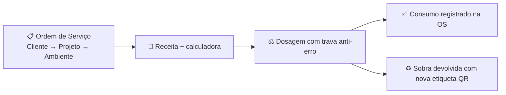
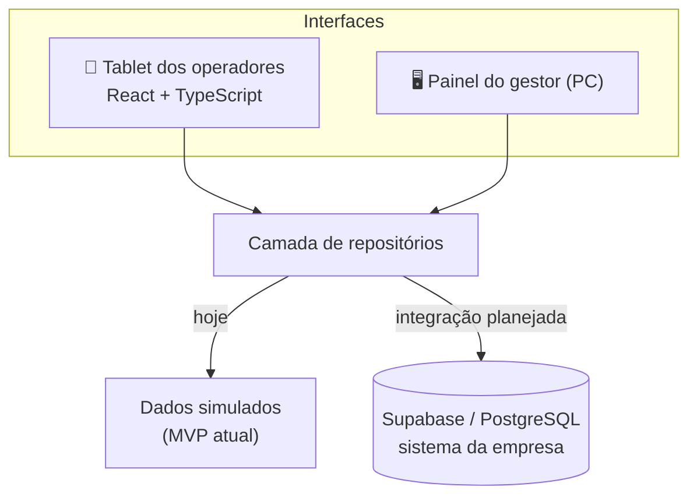

<div align="center">

# 🪵 Gerenciador de Químicos

**Receitas exatas, estoque sob controle e menos desperdício no setor de pintura.**

Sistema web _tablet-first_ para marcenarias de alto padrão: calcula misturas, trava erros de dosagem, rastreia o consumo por cliente e ambiente e dá nova vida às sobras.

[](#-status-e-roadmap)
[](https://www.typescriptlang.org/)
[](https://react.dev/)
[](https://supabase.com/)
[](#-telas)

<!-- [A PREENCHER] Troque pela imagem de capa (colagem das telas ou GIF do fluxo) -->


</div>

---

## 💡 O problema

Em uma marcenaria de alto padrão, o setor de pintura usa produtos caros (bases, catalisadores, diluidores, retardadores e vernizes PU) e as receitas de mistura vivem na cabeça dos pintores.

> _"Composição e mistura, eles sabem de cabeça, e isso é um problema. Preferiria ter um tablet com as receitas, sabe? E eles darem baixa no que forem usando, e associar para qual cliente e ambiente, devolve a lata pro estoque com os valores..."_  
> — Gestor da Mada Marcenaria

O resultado são proporções erradas, latas abertas que voltam ao estoque sem registro, produtos vencendo na prateleira e custo impreciso por obra.

## ✨ A solução

|     | Funcionalidade                     | O que resolve                                                                        |
| :-: | :--------------------------------- | :----------------------------------------------------------------------------------- |
| 📱  | **Interface tablet-first**         | Botões grandes e alto contraste, pensados para uso em pé, com luvas e mãos sujas.    |
| 🧪  | **Receitas dinâmicas**             | Informe o volume total e o sistema calcula base, catalisador, diluidor e retardador. |
| 🛑  | **Trava anti-erro**                | Alerta quando a quantidade retirada passa da receita, com justificativa obrigatória. |
| 📅  | **Prioridade por validade (FEFO)** | Mostra qual lata usar primeiro, para reduzir perdas por vencimento.                  |
| 🏷️  | **QR Code**                        | Identifica latas e ordens de serviço e gera nova etiqueta para as sobras.            |
| 📊  | **Painel do gestor**               | Compara consumo previsto e real e acompanha o custo por cliente e ambiente.          |

## 🔄 Como funciona



## 🖼️ Telas

> **[A PREENCHER]** Adicione os prints em `docs/screens/`.

|             Login rápido              |                  Dashboard                  |                 Vincular OS                  |
| :-----------------------------------: | :-----------------------------------------: | :------------------------------------------: |
|    |  |        |
| PIN de 4 dígitos com foto do operador |     Ações grandes e alerta de validade      | Cliente, projeto e ambiente em poucos toques |

|                 Receita                 |           Alerta anti-erro            |             Devolução de sobras             |           Painel do gestor            |
| :-------------------------------------: | :-----------------------------------: | :-----------------------------------------: | :-----------------------------------: |
|  |  |  |  |
|         Calculadora de mistura          |      Trava ao exceder a receita       |          Nova etiqueta com QR Code          |       Consumo previsto vs. real       |

## 🎯 Impacto esperado

- **−20% de desperdício** de químicos (meta até novembro de 2026).
- Receitas padronizadas, sem depender da memória de cada operador.
- **Custo real** por cliente, projeto e ambiente.
- Menos latas vencidas e mais sobras reaproveitadas.

## 🏗️ Arquitetura



Uma camada de repositórios isola a origem dos dados: o MVP roda com dados simulados e, quando o acesso ao sistema da empresa for liberado, a troca para o Supabase é feita por configuração. As tabelas da empresa são lidas em modo somente leitura, e as entidades novas (receitas, preparações, movimentações) ficam em um schema separado.

## 🧰 Tecnologias

| Camada        | Tecnologia                                                        |
| :------------ | :---------------------------------------------------------------- |
| Interface     | React, TypeScript, HTML5, CSS com design tokens                   |
| Dados         | PostgreSQL via Supabase                                           |
| Identificação | Leitura de QR Code via WebRTC                                     |
| Design        | Design system próprio, tema escuro e alto contraste, tablet-first |

## 🚧 Status e roadmap

> O projeto está em desenvolvimento. A versão atual é um **MVP demonstrável com dados simulados**; a integração com o sistema da empresa depende da liberação de acesso aos dados reais.

**Já prototipado**

- [x] Login rápido com PIN
- [x] Dashboard operacional com alerta de validade
- [x] Vinculação de cliente, projeto e ambiente
- [x] Receita com calculadora dinâmica
- [x] Dosagem com trava anti-erro
- [x] Devolução de sobras com etiqueta QR
- [x] Painel do gestor

**Próximos passos**

- [ ] Integração com o Supabase da empresa
- [ ] Recebimento de lotes e validades
- [ ] Cadastro/importação de ordens de serviço
- [ ] Perfis de acesso e trilha de auditoria
- [ ] Relatórios exportáveis (CSV/PDF)
- [ ] Operação offline com sincronização
- [ ] Tempo de vida útil da mistura

## 📚 Documentação

| Documento                                          | Conteúdo                                                              |
| :------------------------------------------------- | :-------------------------------------------------------------------- |
| [Documentação do projeto](docs/PROJETO.md)         | Contexto, requisitos, objetivos, cronograma, riscos e modelo de dados |
| [Guia de design](docs/DESIGN.md)                   | Princípios de UX e design system para chão de fábrica                 |
| [Project Model Canvas](docs/CANVAS.md)             | Planejamento do projeto em matriz                                     |
| [Decisões e reuniões](docs/DECISOES_E_REUNIOES.md) | Registro de decisões e feedbacks                                      |

## ▶️ Como executar

> **[A PREENCHER]** Exemplo de estrutura; ajuste aos scripts reais do projeto.

```bash
git clone <URL-DO-REPOSITORIO>
cd mada
npm install
cp .env.example .env     # preencher as variáveis
npm run dev
```

Por padrão a aplicação usa dados simulados (`DATA_SOURCE=mock`). Para usar o Supabase, configure `SUPABASE_URL` e `SUPABASE_ANON_KEY` no `.env`. Nunca versione chaves reais e nunca use a chave `service_role` no front-end.

## 👥 Equipe

> **[A PREENCHER]** Nome, função e link de cada integrante.

| Integrante | Função             | Contato             |
| :--------- | :----------------- | :------------------ |
| [Nome]     | Gerente de Projeto | [GitHub / LinkedIn] |
| [Nome]     | Banco de Dados     | [GitHub / LinkedIn] |
| [Nome]     | Integração         | [GitHub / LinkedIn] |
| [Nome]     | Back-end           | [GitHub / LinkedIn] |
| [Nome]     | Front-end / UX     | [GitHub / LinkedIn] |

Projeto de curricularização desenvolvido em parceria com a **Mada Marcenaria** (São Bernardo do Campo, SP). **[A PREENCHER: instituição e disciplina]**

## 📄 Licença e uso

> **[A DEFINIR]** Escolha a licença junto com a empresa e a instituição antes de tornar o repositório público.
