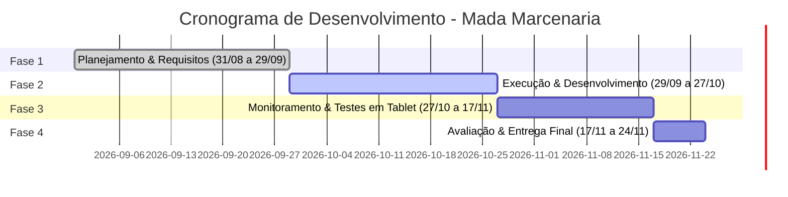
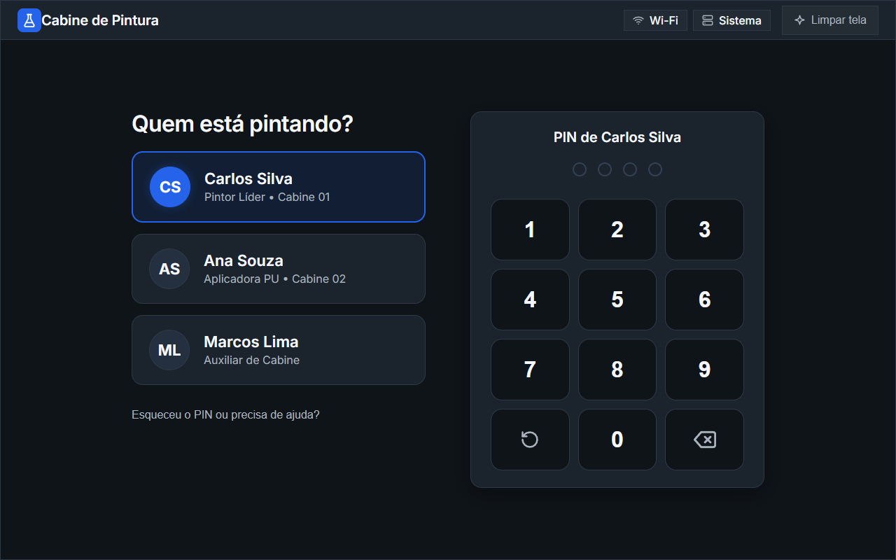
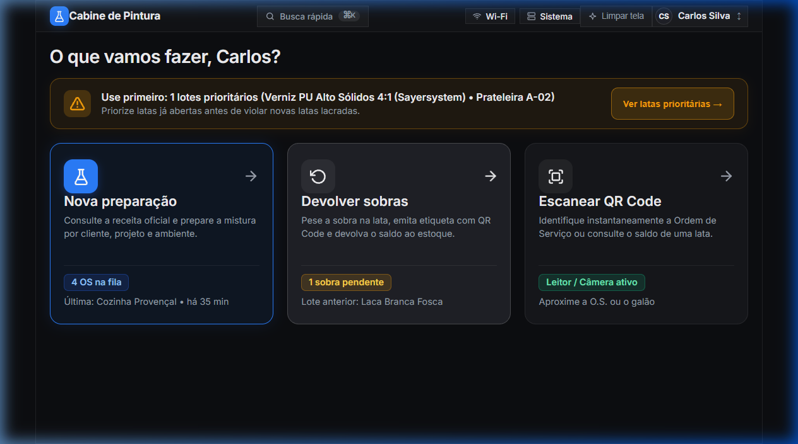
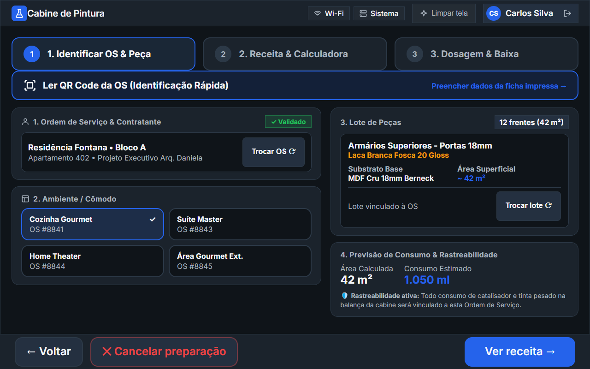
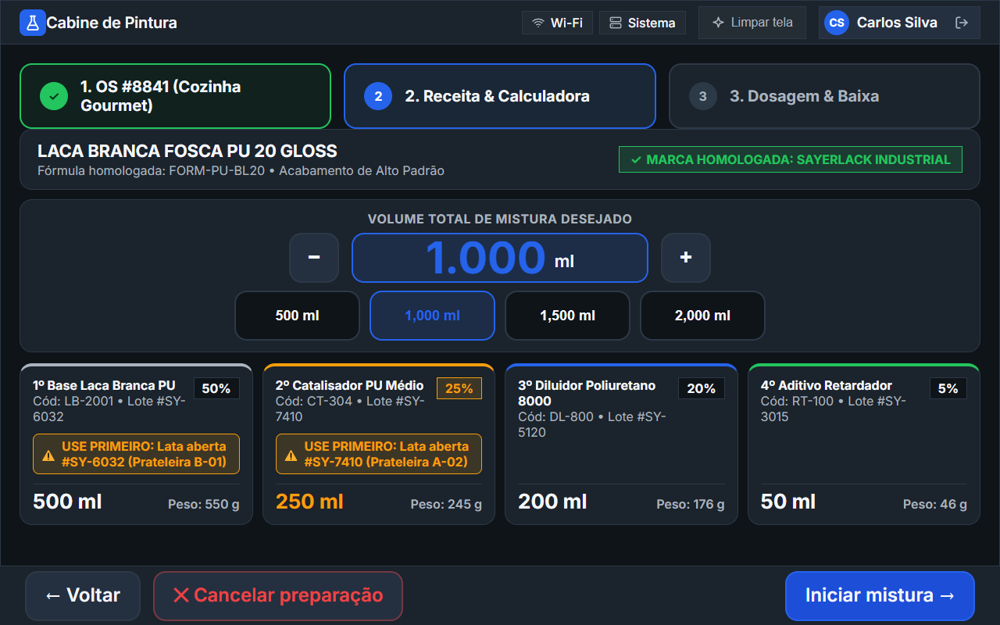
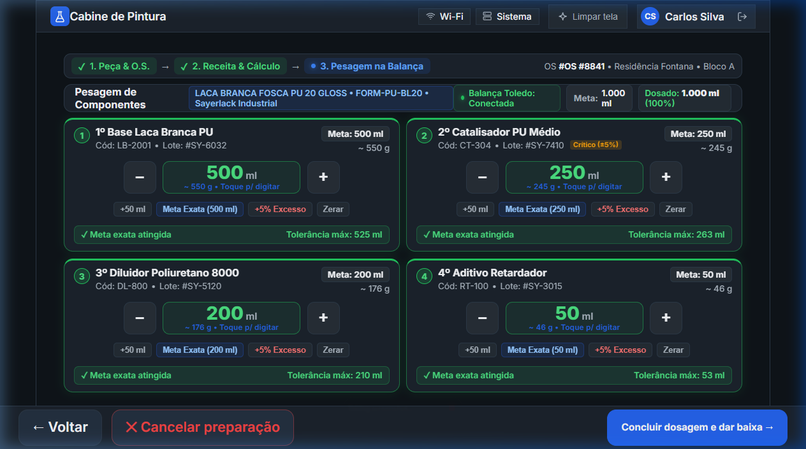
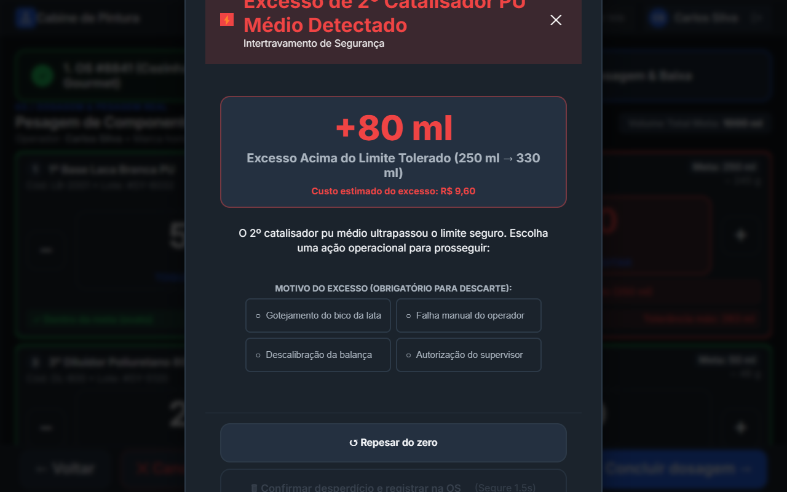
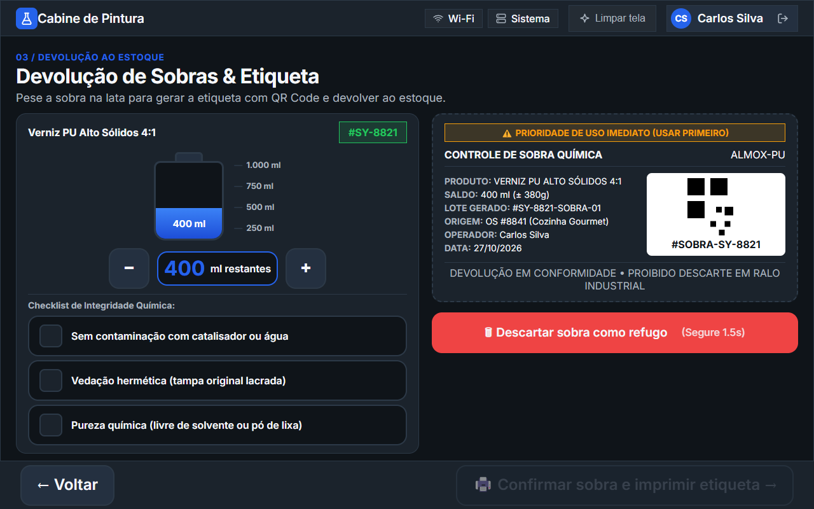
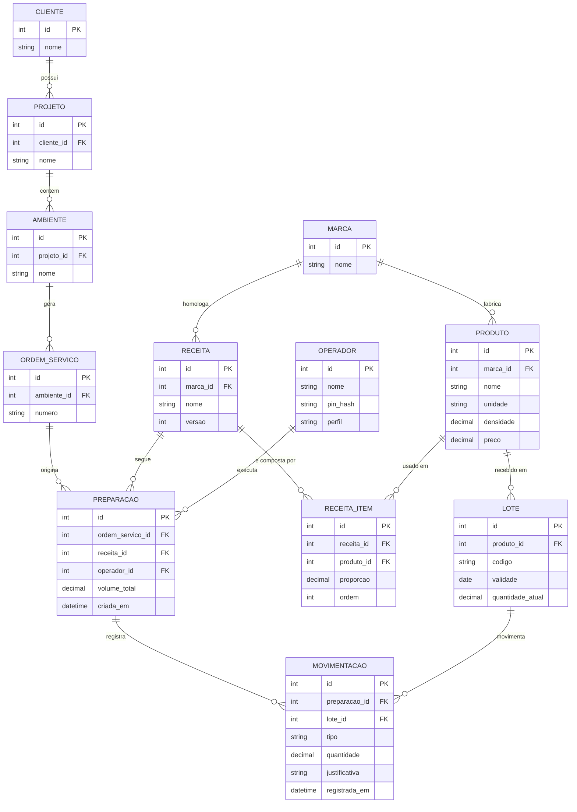

[← Voltar ao README](../README.md)

# 🪵 Mada Marcenaria — Sistema de Gestão de Químicos & Receitas

> **Projeto de Curricularização Acadêmica**  
> Solução web _tablet-first_ para controle de estoque, pesagem, consumo e devolução de insumos químicos (tintas, vernizes, catalisadores e solventes) no setor de pintura e acabamento de marcenaria de alto padrão.

> **Status atual:** MVP demonstrável com **dados simulados**. A integração com o sistema já existente da empresa (hospedado no Supabase) está planejada e depende da liberação de acesso aos dados reais.

---

## 📌 Sumário

- [⚡ Sprint Relâmpago — MVP Demonstrável (17/10 a 19/10)](#-sprint-relâmpago--mvp-demonstrável-1710-a-1910)
- [1. Contexto & Apresentação da Empresa](#1-contexto--apresentação-da-empresa)
- [2. O Problema & Diagnóstico](#2-o-problema--diagnóstico)
- [3. A Solução Proposta](#3-a-solução-proposta)
  - [3.1 Integração com o Sistema Existente (Supabase)](#31-integração-com-o-sistema-existente-supabase)
- [4. Objetivos do Projeto (SMART)](#4-objetivos-do-projeto-smart)
- [5. Partes Interessadas & Equipe](#5-partes-interessadas--equipe)
- [6. Requisitos do Sistema](#6-requisitos-do-sistema)
  - [Requisitos Funcionais (RF)](#requisitos-funcionais-rf)
  - [Requisitos Não Funcionais (RNF)](#requisitos-não-funcionais-rnf)
  - [6.1 Regras de Negócio em Validação](#61-regras-de-negócio-em-validação)
- [7. Cronograma & Backlog de Entregas](#7-cronograma--backlog-de-entregas)
- [8. Análise de Viabilidade, Custos & Riscos](#8-análise-de-viabilidade-custos--riscos)
- [9. UX, Design & Arquitetura de Telas](#9-ux-design--arquitetura-de-telas)
- [10. Modelo de Dados (DER)](#10-modelo-de-dados-der)
- [11. Tecnologias Utilizadas](#11-tecnologias-utilizadas)
- [12. Como Executar](#12-como-executar)
- [📄 Project Model Canvas (PMC) Completo (CANVAS.md)](./CANVAS.md)
- [📝 Registro de Decisões, Reuniões e Feedbacks (DECISOES_E_REUNIOES.md)](./DECISOES_E_REUNIOES.md)

---

## ⚡ Sprint Relâmpago — MVP Demonstrável (17/10 a 19/10)

> 🎯 **Meta Imediata:** Apresentar uma **versão demonstrável e interativa** para Fábio (proprietário da Mada Marcenaria) na **segunda-feira (19/10/2026)**.  
> O objetivo desta sprint de 48 horas é mostrar o fluxo de ponta a ponta em tablet: tirar as receitas da "cabeça dos operadores", automatizar os cálculos químicos e demonstrar o controle de sobras com barreira anti-erro.

> ⚠️ **Dados simulados:** nomes de produtos, preços, validades, pesos, operadores e ordens de serviço exibidos nesta versão são **fictícios**, pois o acesso ao sistema da empresa ainda não foi liberado (veja [3.1](#31-integração-com-o-sistema-existente-supabase)).

### 📋 Checklist de Telas do MVP

Legenda: `[x]` = tela prototipada e navegável (com dados simulados).

- [x] **1. Login Rápido & Seleção de Operador**
  - [x] Cards táteis dos operadores com foto
  - [x] Teclado numérico PIN de 4 dígitos, com estados de erro
  - [x] Indicador visual de status de conexão (Wi-Fi/sistema), com aviso em faixa quando offline
- [x] **2. Dashboard Principal do Chão de Fábrica**
  - [x] 3 botões gigantes de toque com luvas: `NOVA PREPARAÇÃO`, `DEVOLVER SOBRAS`, `ESCANEAR QR CODE`
  - [x] Alerta de latas abertas ou com validade próxima ("Use primeiro", regra FEFO)
- [x] **3. Identificação da Ordem de Serviço (OS)**
  - [x] Rastreabilidade em 3 níveis: Cliente > Projeto > Ambiente (ex: _Residência Alphaville > Armários Master > Laca PU_)
  - [x] Simulação de escaneamento de QR Code da ficha impressa
- [x] **4. Ficha Técnica & Calculadora Dinâmica de Mistura (O Gabarito)**
  - [x] Seleção da receita/acabamento homologado ([Sayerlack Sayersystem](https://www.sayerlack.com.br/cartela_sayersystem.pdf))
  - [x] Input do volume total de acabamento desejado (ex: 500 ml, 1.000 ml, 2.000 ml)
  - [x] Recálculo dinâmico e instantâneo das frações químicas:
    - **Base PU** (ml)
    - **Catálise (Endurecedor)** (ml)
    - **Diluidor** (ml)
    - **Retardador** (ml)
  - [x] Exibição da marca correta a retirar da prateleira
- [x] **5. Check-out de Consumo com Barreira Anti-Erro ("Sistema Anti-Burro")**
  - [x] Controles de pesagem com botões táteis ampliados (`+` e `-`)
  - [x] **🚨 Modal Anti-Erro (Prevenção Ativa):** bloqueio com alerta em vermelho caso a quantidade retirada exceda a receita, exigindo justificativa e confirmação de desperdício
- [x] **6. Devolução de Sobras & Etiquetagem de Saldo**
  - [x] Registro do volume restante que volta ao almoxarifado (ex: lata de 1L com 400 ml de sobra)
  - [x] Emissão simulada da nova etiqueta com QR Code para identificação do frasco aberto
- [ ] **7. Painel do Gestor (planejado; existem apenas os componentes KpiCard e DataTable)**
  - [ ] Indicadores de consumo, taxa de reintegração de sobras e custo previsto vs. realizado (planejado)
  - [ ] Visão geral das cabines de pintura (**ilustrativa**: telemetria de cabines e balanças **não faz parte do escopo atual**)

---

## 1. Contexto & Apresentação da Empresa

A **Mada Marcenaria**, localizada em São Bernardo do Campo – SP, é uma marcenaria tradicional e familiar que atravessa três gerações, hoje sob gestão de Fábio. Atua no nicho de móveis sob medida e marcenaria de **alto padrão**, atendendo renomados escritórios de arquitetura, construtoras, imobiliárias e clientes de perfil exigente.

- **Estrutura:** Amplo galpão industrial equipado com maquinários modernos.
- **Quadro de Pessoal:** Aproximadamente 120 colaboradores divididos entre RH, Engenharia de Produção, Gestão, TI, Operadores de Máquinas, Marceneiros e Pintores.
- **Etapa Crítica:** O setor de **Pintura e Acabamento** representa um dos processos mais custosos e determinantes para a qualidade final da peça entregue.

---

## 2. O Problema & Diagnóstico

Durante a imersão e o diálogo direto com Fábio (gestor da Mada Marcenaria), identificou-se que a empresa **não possui um gerenciador próprio para insumos químicos e receitas**.

> _"Composição e mistura, eles sabem de cabeça, e isso é um problema. Preferiria ter um tablet com as receitas, sabe? E eles darem baixa no que forem usando, E ASSOCIAR PARA QUAL CLIENTE E AMBIENTE, devolve a lata pro estoque com os valores..."_  
> — **Fábio, gestor da Mada Marcenaria**

### Principais Dores Diagnosticadas:

1. **Dependência da Memória ("Sabem de Cabeça"):** As receitas e proporções não estão centralizadas em um sistema digital. Se um operador com experiência falta ou se a marca de tinta muda, ocorrem erros críticos de proporção.
2. **Perda de Produtos Abertos:** Latas de químicos de alto valor (bases, vernizes PU, catalisadores, diluidores e retardadores) são abertas para atender a uma ordem de serviço, não são consumidas por completo e retornam ao almoxarifado sem registro de saldo ou identificação.
3. **Vencimento no Estoque:** Como não há controle de prioridade (FIFO/FEFO por validade), operadores acabam abrindo novas latas lacradas enquanto recipientes abertos ou com validade próxima vencem na prateleira.
4. **Custeio e Rastreabilidade Imprecisos:** Dificuldade em apontar o gasto real de químicos por projeto, cliente e ambiente.
5. **Variação entre Marcas e Fórmulas:** Mudanças de fabricantes alteram as proporções das receitas, gerando desperdício e retrabalho.
6. **Conhecimento não documentado:** As receitas atuais existem principalmente na experiência dos pintores, o que exige um levantamento junto a eles antes de cadastrá-las no sistema.

---

## 3. A Solução Proposta

Desenvolvimento de uma **aplicação web em TypeScript**, otimizada para operação em **tablets no chão de fábrica**, integrada à rotina operacional do setor de pintura e acabamento da Mada Marcenaria e aos dados do sistema que a empresa já utiliza.

```
       [ Ordem de Serviço (Cliente / Projeto / Ambiente) ]
                              │
                              ▼
        [ Consulta de Receita & Gabarito da Marca ]
                              │
                              ▼
      [ Calculadora Dinâmica de Mistura (Bases/Catalisadores) ]
                              │
                              ▼
          [ Baixa com Validação Anti-Erro & QR Code ]
                              │
                ┌─────────────┴─────────────┐
                ▼                           ▼
      [ Consumo Efetivo ]          [ Devolução de Sobras ]
    (Registro no Projeto)       (Re-etiquetagem com QR Code)
```

### Principais Pilares:

- **Tablet-First & Chão de Fábrica:** Botões dimensionados para toque com luvas, contraste elevado sob iluminação fabril e fluxos de poucos toques.
- **Prevenção Ativa de Erros (UX Defensiva):** Bloqueios visuais e alertas caso o volume retirado destoe da receita padrão ("sistema anti-erro").
- **Cálculo de Formulação por Componentes:** O motor recalcula automaticamente os componentes da receita. O caso padrão tem 4 componentes, e o modelo de dados prevê receitas com número variável (ex.: seladores com apenas dois):
  - **Base** (tinta ou verniz);
  - **Catálise (PU):** Reagente de cura para alto brilho e resistência;
  - **Diluidor:** Ajuste de viscosidade para aplicação;
  - **Retardador:** Estabilizador de secagem contra umidade/névoa.
- **Padrão Técnico de Cores:** Compatibilidade com o catálogo [Sayerlack — Sayersystem](https://www.sayerlack.com.br/cartela_sayersystem.pdf).
- **Rastreabilidade por QR Code:** Identificação rápida de insumos e rotulagem de sobras com registro de volume remanescente.
- **Integração com o Sistema da Empresa:** Reaproveitamento dos dados de produtos, preços, lotes e validades já existentes (veja [3.1](#31-integração-com-o-sistema-existente-supabase)).
- **Descarte Ambientalmente Consciente:** O resíduo consumido é direcionado para tambores de coleta de empresas especializadas de destinação ambiental.
- **Meta Operacional:** **Redução de 20% no desperdício de materiais químicos** até novembro de 2026.

### 3.1 Integração com o Sistema Existente (Supabase)

A Mada Marcenaria já possui um sistema próprio, hospedado no **Supabase**, com as informações sobre os insumos que utiliza. Este projeto será integrado a esses dados em **modo de leitura**; as entidades novas (receitas, preparações, movimentações e sobras) ficam em um **schema separado**, sem alterar as tabelas da empresa.

**Situação atual:** o acesso aos dados reais ainda não foi liberado. O MVP usa **dados fictícios** por meio de uma camada de repositórios (`ProdutoRepository`, `LoteRepository`, `OsRepository`, etc.) com duas implementações: uma simulada e outra baseada no Supabase. Quando o acesso estiver disponível, a troca é feita por configuração.

**Contrato de dados (o que o projeto precisa receber):**

| Dado                            | Campos mínimos                                                               |
| :------------------------------ | :--------------------------------------------------------------------------- |
| Produtos                        | nome, marca, código, unidade de medida, densidade (se houver pesagem), preço |
| Lotes                           | lote, produto, validade, quantidade                                          |
| Clientes, projetos e ambientes  | os já utilizados nas ordens de serviço                                       |
| Receitas existentes (se houver) | componentes e proporções                                                     |

**Boas práticas de segurança na integração:**

- Solicitar **acesso somente leitura** (ou exportação em CSV) aos dados da empresa.
- A chave `service_role` do Supabase **nunca** deve ser usada no front-end; apenas a chave pública, com regras de segurança por linha (RLS) ativas.

---

## 4. Objetivos do Projeto (SMART)

### 🎯 Objetivo Central (SMART)

> **"Desenvolver e implantar, até novembro de 2026, um protótipo de sistema web otimizado para tablets, integrado ao sistema existente da empresa, capaz de registrar e controlar a retirada, o consumo e a devolução de materiais utilizados na produção, permitindo comparar o consumo realizado com os parâmetros definidos e contribuindo para uma redução de 20% no desperdício de materiais."**

### Objetivos Específicos

- Centralizar o catálogo de receitas e acabamentos homologados pela marcenaria.
- Permitir consulta ágil e recalculada de misturas em tablets operacionais.
- Registrar a baixa de produtos com rastreabilidade por Cliente, Projeto, Ambiente e Etapa.
- Gerenciar embalagens parciais (ex: latas de 1L ou galões) e devolução formal de sobras ao estoque.
- Priorizar a ordem de uso de materiais pela data de validade (mitigando perdas por vencimento).
- Permitir leitura e identificação de insumos via QR Code.
- Mapear a relação entre Marcas, Produtos e Fórmulas, suportando trocas de fornecedores sem perda de consistência.
- Desenvolver a solução sem dependência de instalação em servidores locais físicos da empresa (nuvem, com integração ao Supabase).
- Estabelecer uma **linha de base** de desperdício antes do uso do sistema, para medir a meta de 20%.

### Como a meta de 20% será medida

> **[A DEFINIR com a empresa]** A proposta abaixo precisa ser validada.

- **Linha de base:** levantar o desperdício atual por meio de contagem de estoque e consumo por obra nas últimas semanas ou, se não houver dados, de um registro manual por 1 a 2 semanas.
- **Indicador sugerido:** Desperdício (%) = (volume descartado + excesso retirado acima da receita) ÷ volume total retirado.
- **Comparação:** repetir a medição durante o uso do sistema e comparar com a linha de base.

---

## 5. Partes Interessadas & Equipe

### Stakeholders Externos

| Stakeholder                             | Papel & Interesse Principal                                                                  |
| :-------------------------------------- | :------------------------------------------------------------------------------------------- |
| **Mada Marcenaria (Diretoria / Fábio)** | Patrocinadora; validação de regras de negócio, redução de custos e de desperdício.           |
| **Operadores (Pintores e Marceneiros)** | Usuários finais no tablet; agilidade na consulta de receitas e baixa sem burocracia.         |
| **Almoxarifado & Compras**              | Controle de estoque físico, recebimento de sobras, gestão de validades e compras assertivas. |
| **Gerência de Produção & Engenharia**   | Acompanhamento do previsto vs. realizado e custos reais por projeto.                         |
| **Instituição de Ensino & Professores** | Orientação metodológica, avaliação acadêmica e monitoria do projeto de curricularização.     |

### Estrutura da Equipe de Desenvolvimento

1. **Gerente de Projeto (PM):** Gestão do cronograma, comunicação com a empresa e entregáveis acadêmicos.
2. **Banco de Dados:** Modelagem conceitual, lógica e física relacional (DER).
3. **Integração:** Arquitetura de rede, integração com o Supabase e testes de conexão fabril.
4. **Back-end:** Desenvolvimento da API em TypeScript e motor de cálculo de misturas/regras de sobras.
5. **Front-end / UX:** Prototipagem, design system, usabilidade _tablet-first_ e telas web responsivas.

---

## 6. Requisitos do Sistema

Legenda: `[x]` = implementado no MVP (com dados simulados); `[~]` = parcial ou simulado; `[ ]` = planejado.

### Requisitos Funcionais (RF)

- [x] **RF01 - Catálogo de Receitas:** Centralizar e permitir a consulta de fichas técnicas de acabamento (tintas, resinas, vernizes, seladores) (`src/screens/ScreenRecipe.tsx`, `src/data/mock/mockData.ts`).
- [x] **RF02 - Proporções Exatas:** Apresentar produtos e volumes calculados dinamicamente com base na quantidade final desejada, com receitas de número variável de componentes (`src/domain/mixture.ts`, `src/screens/ScreenRecipe.tsx`).
- [x] **RF03 - Rastreabilidade de Consumo:** Registrar retirada e baixa por componente vinculando à Ordem de Serviço (Cliente, Projeto e Ambiente) e ao Operador logado (`src/App.tsx`, `src/screens/ScreenDosing.tsx`, `src/data/mock/mockData.ts`).
- [x] **RF04 - Gestão de Embalagens Parciais (Sobras):** Registrar o retorno do saldo remanescente ao almoxarifado com checklist de integridade e geração de etiqueta de sobra (`src/screens/ScreenReturn.tsx`, `src/domain/leftover.ts`).
- [~] **RF05 - Previsto vs. Real:** Parcial: comparação entre meta teórica da receita e consumo real apontado na pesagem individual com trava de tolerância (`src/screens/ScreenDosing.tsx`); painel gerencial consolidado de histórico previsto vs. realizado é planejado.
- [x] **RF06 - Priorização por Validade:** Indicar a ordem prioritária de retirada de produtos com base no lote e validade (FEFO) (`src/domain/fefo.ts`, `src/screens/ScreenDashboard.tsx`, `src/screens/ModalUseFirst.tsx`).
- [~] **RF07 - Identificação via QR Code:** Simulado via software no protótipo (leitura por câmera planejada); simula leitura de OS e latas e gera etiquetas com QR Code (`src/App.tsx`, `src/screens/ScreenReturn.tsx`).
- [~] **RF08 - Gestão Multimarca:** Parcial: insumos e receitas associados às marcas correspondentes no modelo de dados (`src/data/mock/mockData.ts`) e exibidos na interface; ajuste automático e troca dinâmica de fórmulas por fabricante em interface é planejada.

**Backlog pós-MVP:**

- [ ] **RF09 - Recebimento de Lotes:** Registrar a entrada de produtos com lote e validade e gerar o QR Code da embalagem.
- [ ] **RF10 - Ordens de Serviço:** Cadastrar ou importar OS (cliente, projeto, ambiente) a partir do sistema existente da empresa.
- [ ] **RF11 - Custo por Lote/Produto:** Registrar o preço de compra para calcular o custo real por OS e o custo do desperdício.
- [ ] **RF12 - Perfis, Permissões e Auditoria:** Diferenciar operador, almoxarife e gestor, com registro de quem executou cada ação.
- [ ] **RF13 - Registro de Descarte:** Registrar volume, motivo e destinação de resíduos e refugo.
- [ ] **RF14 - Versionamento de Receitas:** Manter o histórico de alterações (quem, quando e o que valia antes), principalmente em trocas de marca.
- [ ] **RF15 - Tempo de Vida Útil da Mistura:** Contagem regressiva a partir do preparo, com alerta ao final do tempo.
- [ ] **RF16 - Estoque Mínimo e Sugestão de Compra:** Alertar o setor de Compras quando um insumo atingir o nível mínimo.
- [ ] **RF17 - Relatórios Exportáveis:** Exportar consumo e custo por cliente, projeto e ambiente em CSV/PDF.
- [ ] **RF18 - Operação Offline:** Guardar movimentações localmente e sincronizar quando a conexão voltar.

### Requisitos Não Funcionais (RNF)

- **RNF01 - Usabilidade Tablet-First:** Interface com botões grandes (mínimo de 64px), texto mínimo de 16px, áreas de toque expandidas, alto contraste e fluxo à prova de erro (uso com luvas/sujeira de oficina).
- **RNF02 - Compatibilidade Web:** Aplicação web responsiva desenvolvida em TypeScript, executável em navegadores modernos em tablets (Android/iPadOS) e desktop.
- **RNF03 - Resiliência & Desempenho:** Aplicação leve, com tempos de resposta mínimos, feedback claro de status de rede e bloqueio de gravação quando offline (fila de sincronização prevista no RF18).
- **RNF04 - Backups:** Rotina diária de backup dos dados operacionais e de estoque em nuvem. **[A CONFIRMAR conforme o plano do provedor]**
- **RNF05 - Manutenibilidade:** Código modular, camada de repositórios para troca de fonte de dados e banco relacional bem estruturado para inclusão ágil de novas receitas, insumos e fornecedores.
- **RNF06 - Segurança e Privacidade:** PIN armazenado com hash, bloqueio após tentativas incorretas, comunicação por HTTPS, regras de segurança por linha (RLS) e consentimento para o uso de fotos dos operadores (LGPD).
- **RNF07 - Integração Segura:** Acesso aos dados da empresa em modo somente leitura, com novas entidades em schema separado.

### 6.1 Regras de Negócio em Validação

Pontos que dependem de confirmação com a empresa e os pintores. A definição afeta o modelo de dados e as telas.

| Tema              | Pergunta                                                                                                                                                                               | Status   |
| :---------------- | :------------------------------------------------------------------------------------------------------------------------------------------------------------------------------------- | :------- |
| Sobra de mistura  | A mistura já catalisada pode voltar ao estoque, ou só o produto puro da lata aberta? A sobra de mistura deve ser reutilizada em outra peça dentro do tempo de vida útil ou descartada? | Pendente |
| Unidade de medida | A pesagem é feita por peso (g) ou por volume (ml)? Se for por peso, qual a densidade de cada produto?                                                                                  | Pendente |
| Receitas          | Quantos componentes cada tipo de receita possui (acabamentos, fundos, seladores)?                                                                                                      | Pendente |
| Dados de lote     | Onde e como são registrados hoje o lote e a validade dos produtos? Quem cadastra as OS?                                                                                                | Pendente |

---

## 7. Cronograma & Backlog de Entregas

### Fases do Projeto (Ciclo Acadêmico)



> 📅 **Nota:** o cronograma será revisado após a reunião de 19/10/2026, considerando o atraso causado pelo período de provas e a data de liberação do acesso aos dados reais. **[ATUALIZAR após a reunião]**

### Backlog de Entregas

- **Entrega 1:** Documentação detalhada das regras de negócio, validação de requisitos de sobras e processos com a Mada Marcenaria, incluindo o **levantamento das receitas** hoje conhecidas pelos pintores.
- **Entrega 2:** Protótipos de alta fidelidade, design system e modelagem estrutural do banco de dados relacional (_Clientes, Ambientes, Receitas, Materiais, Lotes e Movimentações_).
- **Entrega 3:** Desenvolvimento da aplicação web (Front-end + API em TypeScript) com a lógica de cálculo de misturas e regras de consumo, e integração com o Supabase.
- **Entrega 4:** Integração completa, testes de conectividade em ambiente fabril e validação de usabilidade com tablets.
- **Entrega 5:** Homologação com a empresa, refinamento de feedbacks, entrega do MVP funcional, manual de instrução de uso e **Treinamento/Capacitação presencial dos operadores no uso dos tablets**.

---

## 8. Análise de Viabilidade, Custos & Riscos

### Estimativa Financeira & Orçamento do Piloto

| Rubrica                                            | Cenário Comercial (Mercado)       | Cenário Acadêmico (Piloto Mada)                                                    |
| :------------------------------------------------- | :-------------------------------- | :--------------------------------------------------------------------------------- |
| **Mão de Obra de Desenvolvimento**                 | R$ 25.000,00 _(5 devs / 3 meses)_ | **R$ 0,00** _(subsidiado pela disciplina)_                                         |
| **Infraestrutura / Servidor / Rede**               | R$ 100,00/mês _(Cloud + Backup)_  | **R$ 0,00** _(aproveita o Supabase já utilizado pela empresa — **[A CONFIRMAR]**)_ |
| **Domínio / Registro**                             | ~R$ 40,00 anuais                  | **R$ 0,00** _(subdomínio gratuito de hospedagem — **[A DEFINIR]**)_                |
| **Despesas Operacionais (Visitas/Testes de rede)** | Inclusas em contrato              | **R$ 150,00** _(deslocamento presencial para testes na fábrica)_                   |
| **TOTAL DO INVESTIMENTO**                          | **R$ 25.140,00+**                 | **R$ 150,00**                                                                      |

> 📌 Para a visualização detalhada em matriz do planejamento inicial, consulte o [CANVAS.md](./CANVAS.md).

### Matriz de Riscos & Planos de Ação

| Risco                                                                       | Categoria   | Impacto | Mitigação                                                                                                             |
| :-------------------------------------------------------------------------- | :---------- | :------ | :-------------------------------------------------------------------------------------------------------------------- |
| Uso com luvas, poeira e tinta no tablet                                     | Operacional | Alto    | UI com áreas de clique amplas, botões sem dependência de gestos complexos e confirmações claras.                      |
| Troca de marca sem aviso prévio                                             | Negócio     | Médio   | Sistema com suporte nativo a formulações alternativas indexadas por marca.                                            |
| Instabilidade de Wi-Fi no galpão                                            | Técnico     | Médio   | Aplicação leve com feedback claro de status de rede e bloqueio de gravação offline; fila de sincronização no backlog. |
| Resistência operacional / erro humano                                       | Operacional | Médio   | UX defensiva com modais de confirmação ao ultrapassar volumes previstos e interface visual intuitiva.                 |
| Atraso na liberação do acesso aos dados reais                               | Técnico     | Alto    | Camada de repositórios com dados fictícios; contrato de dados enviado à empresa com prazo para resposta.              |
| Receitas não documentadas (conhecimento só na memória dos pintores)         | Negócio     | Alto    | Entrevistas e levantamento das receitas com os pintores e cadastro assistido pelo gestor.                             |
| Prazo curto e atraso acumulado                                              | Gestão      | Médio   | Priorizar o fluxo principal, revisar o cronograma e manter o backlog pós-MVP separado.                                |
| Diferença entre os dados simulados e a estrutura real do sistema da empresa | Técnico     | Médio   | Validar o contrato de dados cedo e isolar a origem dos dados na camada de repositórios.                               |
| Acesso indevido (PIN simples de 4 dígitos)                                  | Segurança   | Médio   | Hash do PIN, bloqueio após tentativas incorretas, registro de auditoria e perfis de acesso.                           |

---

## 9. UX, Design & Arquitetura de Telas

O guia de design completo e as especificações de interface para chão de fábrica estão formalizados no documento:
👉 **Consulte as diretrizes completas em [DESIGN.md](./DESIGN.md)**

### Resumo dos Fluxos Principais (Tablet):

1. **Login:** Seleção por operador + PIN numérico de 4 dígitos (`src/screens/ScreenAuth.tsx`).
2. **Dashboard:** 3 ações primárias de impacto (`NOVA PREPARAÇÃO`, `DEVOLVER SOBRAS`, `ESCANEAR QR CODE`) e alerta FEFO (`src/screens/ScreenDashboard.tsx`).
3. **Vincular OS:** Associação direta a Cliente, Projeto e Ambiente (`src/screens/ScreenOS.tsx`).
4. **Receita:** Calculadora automática da mistura a partir do volume total de acabamento (`src/screens/ScreenRecipe.tsx`).
5. **Dosagem:** Pesagem real em grade 2x2 com NumberStepper de 10 ml, teclado numérico tátil e verificação de tolerância de 5% (`src/screens/ScreenDosing.tsx`).
6. **Alerta de excesso:** Modal de intertravamento de segurança com valores reais e custo estimado do excesso, opções de repesar ou confirmar desperdício (`src/screens/ModalCriticalExcess.tsx`).
7. **Devolução:** Devolução de sobras com checklist de integridade química e emissão de nova etiqueta com QR Code (`src/screens/ScreenReturn.tsx`).

### Painel de Gerência (PC):

8. **Visão do Gestor (Planejado):** Indicadores de consumo, desperdício e custo previsto vs. realizado, além de cadastros de receitas, marcas e produtos (planejado; existem apenas os componentes KpiCard e DataTable).

### 📸 Telas do Sistema

> **[A PREENCHER]** adicione os prints em `docs/screens/` e referencie aqui.

|             Login              |               Dashboard                |       Vincular OS        |
| :----------------------------: | :------------------------------------: | :----------------------: |
|  |  |  |

|              Receita               |                 Dosagem                 |          Alerta de excesso           |               Devolução                |
| :--------------------------------: | :-------------------------------------: | :----------------------------------: | :------------------------------------: |
|  |       |      |  |

---

## 10. Modelo de Dados (DER)

Versão preliminar. As entidades de produtos, lotes e clientes devem ser mapeadas para as tabelas já existentes no Supabase da empresa quando o acesso for liberado.



> `MOVIMENTACAO.tipo` assume os valores: `RETIRADA`, `DEVOLUCAO` e `DESCARTE`.

---

## 11. Tecnologias Utilizadas

- **Linguagem Principal:** [TypeScript 6](https://www.typescriptlang.org/)
- **Interface:** React 19 + TypeScript 6, Web Responsive / Tablet-First (HTML5 e CSS com variáveis de design tokens)
- **Ferramenta de Build:** [Vite 8](https://vite.dev/) (porta 3000)
- **Camada de Dados (MVP):** Repositórios em memória com dados simulados (`src/data/`, seletor `VITE_DATA_SOURCE=mock`)
- **Regras de Negócio:** Módulos de domínio em TypeScript com funções puras (`src/domain/`)
- **Banco de Dados e Backend como Serviço:** PostgreSQL via [Supabase](https://supabase.com/) (integração planejada)
- **Identificação:** QR Code simulado no MVP (leitura real via WebRTC / câmera planejada)
- **Qualidade & Testes:** Vitest 5 (19 testes unitários no domínio), ESLint 10 (Flat Config), Prettier 3

---

## 12. Como Executar

### Pré-requisitos
- **Node.js:** Mínimo comprovado `>=22.12.0` (versão recomendada `24.18.0` indicada em `.nvmrc`)
- **npm:** Gerenciador de pacotes padrão

```bash
git clone <URL-DO-REPOSITORIO>
cd mada
npm install
npm run dev
```

> **Nota:** Por padrão, a aplicação roda imediatamente com dados simulados (`VITE_DATA_SOURCE=mock`) e **não exige configuração de `.env` para execução local**.

Caso deseje configurar variáveis de ambiente (integração futura):

```bash
cp .env.example .env
```

Exemplo de variáveis de ambiente (com prefixo obrigatório `VITE_`):

```ini
# Fonte de dados: "mock" (padrão) ou "supabase"
VITE_DATA_SOURCE=mock
VITE_SUPABASE_URL=
VITE_SUPABASE_ANON_KEY=
```

> Nunca versionar chaves reais, e nunca usar a chave `service_role` no front-end.
